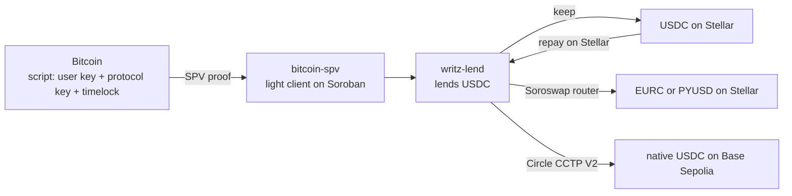

# Writz at HackMeridian 2026: borrow anywhere

Lock native Bitcoin, borrow on Stellar, and receive the loan as the asset you need, on Stellar or on another chain. Your Bitcoin never leaves the Bitcoin network and the loan stays in USDC.

HackMeridian 2026, Lisbon, 25 and 26 October. Scale track. Built on Writz, Soroswap and Circle CCTP V2. Everything runs on testnet.

- **Live app:** [testnet.writz.xyz](https://testnet.writz.xyz)
- **Event work:** pull requests with the [`hackmeridian`](https://github.com/WritzProtocol/writz/pulls?q=label%3Ahackmeridian) label, tracked in [#319](https://github.com/WritzProtocol/writz/issues/319)
- **Prior work ends at:** tag [`hackmeridian-start`](https://github.com/WritzProtocol/writz/tree/hackmeridian-start) (`0a7c65c`, 25 Oct 01:00 Lisbon). No commits landed on `main` between the tag and the 09:00 start of hacking. Event work is the pull requests merged after it with the `hackmeridian` label, listed below; other work on `main` in the same days (documentation upkeep, an unrelated lender-yield sprint) is not claimed.

## The problem

Borrowing against crypto is a large market: 56.16 billion USD of crypto-collateralized loans were outstanding at the end of Q2 2026 ([Galaxy Research](https://www.galaxy.com/insights/research/)). Yet only about 1% of Bitcoin has been wrapped to reach DeFi (WBTC and cbBTC together hold about 212,000 of 20.1 million BTC, CoinGecko, 24 Oct 2026). Every current route to borrow against Bitcoin asks the holder to trust a custodian, a bridge or a wrapper, and each of those has failed in public: Celsius froze withdrawals in 2022, 64% of the 3.1 billion USD stolen from DeFi in 2022 came from cross-chain bridges (Chainalysis), and WBTC's custody changed hands in 2024.

Writz lets a holder borrow against Bitcoin that stays in a script built from their own key, on the Bitcoin network, verified on Stellar by a Bitcoin light client. At this event we add the other half: receiving the money in the form the borrower actually needs.

## Goals set before the event

Submitted with the Scale application on 21 October, word for word. A goal is ticked only when it is merged and shown on testnet, with its transactions. All four were shown on testnet.writz.xyz: goals 2 to 4 have browser transactions from 26 October, and goal 1's on-chain verification is in the full cycle of 25 October (see On-chain evidence).

- [x] **1. A new borrow screen where the user sees their Bitcoin deposit verified and the Bitcoin price at which the position would be liquidated.**
  Status: merged: deposit status endpoint [#326](https://github.com/WritzProtocol/writz/pull/326) and [#333](https://github.com/WritzProtocol/writz/pull/333), deposit card [#336](https://github.com/WritzProtocol/writz/pull/336); the borrow screen hands off to the receive step [#321](https://github.com/WritzProtocol/writz/pull/321). Live on testnet.writz.xyz.
- [x] **2. Receiving the loan as at least one other Stellar asset (EURC or XLM) instead of USDC.**
  Status: merged: swap [#320](https://github.com/WritzProtocol/writz/pull/320), second step with recovery [#321](https://github.com/WritzProtocol/writz/pull/321), receive-as selector [#336](https://github.com/WritzProtocol/writz/pull/336), and EURC, PYUSD and a USDT0 test token through Soroswap [#361](https://github.com/WritzProtocol/writz/pull/361), [#362](https://github.com/WritzProtocol/writz/pull/362). Shown first with XLM, then with EURC (the stablecoins are the default; XLM stays available for testing).
- [x] **3. Receiving the loan as native USDC on at least one other blockchain.**
  Status: merged: burn on Stellar [#320](https://github.com/WritzProtocol/writz/pull/320), attested by Circle on testnet; the relay that completes the mint on Base Sepolia [#328](https://github.com/WritzProtocol/writz/pull/328), [#335](https://github.com/WritzProtocol/writz/pull/335). The relay completed the mint on Base Sepolia from the browser on 26 October (see On-chain evidence).
- [x] **4. Repaying the loan in USDC on Stellar from the same screen.**
  Status: merged: repay from the loan screen (prior work) with the full-cycle timeline, relayer side [#332](https://github.com/WritzProtocol/writz/pull/332) and screen [#336](https://github.com/WritzProtocol/writz/pull/336).

## Try it

Step-by-step guides with screenshots, written at the event: [docs.writz.xyz/guides/start-here](https://docs.writz.xyz/guides/start-here) (wallets, test funds, borrow, repay and release, lend, troubleshooting).

On [testnet.writz.xyz](https://testnet.writz.xyz) you need:

1. **A Stellar wallet on testnet.** Freighter with the network set to Testnet, funded from [friendbot](https://lab.stellar.org/account/fund). The app adds the USDC trustline for you when you borrow.
2. **A Bitcoin wallet on Signet.** Xverse with the network set to Signet, and coins from [bitcoinsignetfaucet.com](https://bitcoinsignetfaucet.com/) or [signetfaucet.com](https://signetfaucet.com). One faucet payout covers the testnet minimum deposit of 5,000 sats.
3. **Borrow:** lock BTC, wait for one Signet confirmation (about 10 minutes; mainnet requires six), borrow USDC, and choose how to receive it: keep USDC, convert to EURC, PYUSD, the Writz USDT0 test token or XLM (XLM for testing only), or send USDC to an address on Base Sepolia.
4. **Repay** in USDC on Stellar from the same screen.


## Run it locally

Requirements: [Bun](https://bun.sh) and Node 24 (pinned in `frontend/app/.tool-versions`).

```bash
git clone https://github.com/WritzProtocol/writz.git
cd writz/frontend/app
bun install
cp .env.example .env.local   # testnet values are already filled in
bun run dev                  # http://localhost:3000
```

Every screen state, without wallets or network: `NEXT_PUBLIC_UI_MOCK=1 bun run dev`, then open `/dev/scenarios`, and `/dev/receive` for the receive step.

Tests: `bun test src` in `frontend/app`.

### Environment variables used by the event work

The first three come from `frontend/app/.env.example`. The others are optional on testnet: unset, they fall back to the values below; on a mainnet build they are empty and the receive options stay off.

| Variable | Testnet default | What it is |
|---|---|---|
| `NEXT_PUBLIC_WRITZ_LEND_ID` | `CC7XGEWAUNUHZYKM5CED6KQXGFS6UWVI5H6XOB76YTMZRWCEH6DKT62A` | The lending contract |
| `NEXT_PUBLIC_BITCOIN_SPV_ID` | `CBX23YKCCJMAMBMSCNP6YVKEXUIYK2CTKSR4TQ3RVBPAFYZFVCW7W4EO` | The Bitcoin light client |
| `NEXT_PUBLIC_USDC_TOKEN_ID` | `CBIELTK6YBZJU5UP2WWQEUCYKLPU6AUNZ2BQ4WWFEIE3USCIHMXQDAMA` | Circle testnet USDC (the pool asset, and the asset CCTP burns) |
| `NEXT_PUBLIC_SOROSWAP_ROUTER_ID` | `CCJUD55AG6W5HAI5LRVNKAE5WDP5XGZBUDS5WNTIVDU7O264UZZE7BRD` | Soroswap router |
| `NEXT_PUBLIC_XLM_TOKEN_ID` | `CDLZFC3SYJYDZT7K67VZ75HPJVIEUVNIXF47ZG2FB2RMQQVU2HHGCYSC` | Native XLM Stellar Asset Contract |
| `NEXT_PUBLIC_CCTP_TOKEN_MESSENGER_MINTER_ID` | `CDNG7HXAPBWICI2E3AUBP3YZWZELJLYSB6F5CC7WLDTLTHVM74SLRTHP` | Circle CCTP V2 on Stellar (domain 27) |
| `NEXT_PUBLIC_CCTP_IRIS_URL` | `https://iris-api-sandbox.circle.com` | Circle's attestation service |

The full list for the app is in [`frontend/app/.env.example`](frontend/app/.env.example).

## How it works



1. The borrower locks BTC in a P2WSH script built from their own key, the protocol key and a timelock. The BTC never leaves Bitcoin.
2. The relayer builds an SPV proof; `writz-lend` asks `bitcoin-spv` to verify it on chain and records the position.
3. The borrower borrows USDC from the `writz-lend` pool, up to a 150% collateral ratio.
4. **New at the event:** a second step receives the loan in the chosen form. The debt always stays in USDC on Stellar.
5. Repaying in USDC on Stellar lets the borrower take the BTC back.

## Architecture of the new work

Everything new for the goals runs in the testnet app and the relayer. The live testnet app runs on one contract change made during the event, for an outside reason: testnet's ledger state rose above its target size, which raised storage rent so much that a new deposit on the previous deployment (`writz-lend` `CCMSOCBV...`, `bitcoin-spv` `CAHHY4S4...`) needed more fee than a transaction can carry. [#340](https://github.com/WritzProtocol/writz/pull/340) makes the storage lifetime of new entries a deployment parameter (shorter on testnet, unchanged on mainnet), and both contracts were redeployed on 25 October. #340 changes no economic logic, authorization or Bitcoin verification. A separate hardening of `writz-lend` ([#356](https://github.com/WritzProtocol/writz/pull/356): timelock margin against the light client tip, liquidation cutoff, distinct user and protocol keys) was merged on 26 October; it is not claimed as goal work, and its testnet deployment is staged but not active yet, so the app still uses `CABF7VK7…`.

| Piece | Where | What it does |
|---|---|---|
| Swap to another stablecoin | [`frontend/app/src/lib/receive/swap.ts`](frontend/app/src/lib/receive/swap.ts) | Quotes with `router_get_amounts_out`, quotes again right before signing, then `swap_exact_tokens_for_tokens` with a minimum output (0.5% slippage by default, 5% at most) and a 5 minute deadline |
| Send to Base Sepolia | [`frontend/app/src/lib/receive/cctp.ts`](frontend/app/src/lib/receive/cctp.ts) | Allowance for the TokenMessengerMinter when needed, then `deposit_for_burn` to domain 6 with the EVM address as bytes32, the amount rounded to CCTP's 6 decimals and the fee from Circle's fee API; reads Circle's attestation |
| Second step and recovery | [`frontend/app/src/components/loan/ReceiveStep.tsx`](frontend/app/src/components/loan/ReceiveStep.tsx), [`lib/receive/intent.ts`](frontend/app/src/lib/receive/intent.ts) | After the borrow settles, converts or sends as the borrower chose. If the second signature is declined or fails, the USDC stays in the wallet and the borrower can try again or keep it |
| Mint relay | Relayer, [#328](https://github.com/WritzProtocol/writz/pull/328), [#335](https://github.com/WritzProtocol/writz/pull/335) | Completes `receiveMessage` on Base Sepolia, so the borrower needs no wallet or gas there |

### Contracts used (testnet)

| Contract | Address |
|---|---|
| `bitcoin-spv` (2026-10-25 redeploy) | `CBX23YKCCJMAMBMSCNP6YVKEXUIYK2CTKSR4TQ3RVBPAFYZFVCW7W4EO` |
| `writz-lend` (2026-10-25 redeploy: 1 confirmation, 5,000 sats minimum) | `CC7XGEWAUNUHZYKM5CED6KQXGFS6UWVI5H6XOB76YTMZRWCEH6DKT62A` |
| Circle USDC (SAC) | `CBIELTK6YBZJU5UP2WWQEUCYKLPU6AUNZ2BQ4WWFEIE3USCIHMXQDAMA` |
| Soroswap router | `CCJUD55AG6W5HAI5LRVNKAE5WDP5XGZBUDS5WNTIVDU7O264UZZE7BRD` |
| Soroswap USDC/XLM pair | `CCBX3NZTCQLQFSPG7HBOKL4P2RVPOPVFHDNRTOSCCJWBTPL2GHEH7RQS` |
| CCTP TokenMessengerMinter (Stellar) | `CDNG7HXAPBWICI2E3AUBP3YZWZELJLYSB6F5CC7WLDTLTHVM74SLRTHP` |
| CCTP MessageTransmitterV2 (Base Sepolia) | `0xE737e5cEBEEBa77EFE34D4aa090756590b1CE275` |

## Developer packages, first published at the event

So other Stellar projects can verify Bitcoin themselves, the two client packages went public during HackMeridian. They were made publishable just before the event ([#300](https://github.com/WritzProtocol/writz/pull/300), [#303](https://github.com/WritzProtocol/writz/pull/303), prior work); their first releases are event work.

| Package | Registry | Releases during the event |
|---|---|---|
| [`@writz/sdk`](https://www.npmjs.com/package/@writz/sdk): TypeScript client to prove a Bitcoin transaction against `bitcoin-spv` and read `writz-lend` | npm | 0.1.0 and 0.1.1 on 25 Oct, 0.1.2 with the 2026-10-25 testnet contracts on 26 Oct ([#334](https://github.com/WritzProtocol/writz/pull/334), [#353](https://github.com/WritzProtocol/writz/pull/353)) |
| [`writz-spv-client`](https://crates.io/crates/writz-spv-client): Soroban client for `bitcoin-spv`, to prove a Bitcoin transaction from a Stellar smart contract | crates.io | 0.1.0 and 0.1.1 on 25 Oct ([#347](https://github.com/WritzProtocol/writz/pull/347)) |

Both publish through trusted publishing from GitHub Actions, with no long-lived registry tokens ([#346](https://github.com/WritzProtocol/writz/pull/346)).

```bash
npm install @writz/sdk
cargo add writz-spv-client
```

## Why it is composed

- **Writz** verifies native Bitcoin on Stellar and lends against it, but pays out only USDC on Stellar.
- **Soroswap** turns that USDC into EURC or PYUSD in one call with a guaranteed minimum.
- **Circle CCTP** moves the same USDC to another chain by burning and minting it, with nothing wrapped and no pool.
- **Any Stellar builder** can reuse the base layer: `bitcoin-spv` is an on-chain verifier, and the published `@writz/sdk` and `writz-spv-client` let another contract check a native Bitcoin payment without trusting Writz.

Together, Stellar can become the credit layer for native Bitcoin: the collateral is verified, the loan is held and repaid on Stellar, wherever the money is spent.

## Security and limits

- The receive features call the Soroswap router and Circle's contracts with standard calls. The contracts the app runs on changed once during the event ([#340](https://github.com/WritzProtocol/writz/pull/340)), only to set how long new storage entries live. The [#356](https://github.com/WritzProtocol/writz/pull/356) hardening is merged but not active on testnet yet.
- The swap and the transfer are a second transaction. If it fails, the borrowed USDC stays in the wallet; only the network fee is spent.
- The swap has a minimum output and a deadline; a price move beyond the slippage makes it revert instead of filling badly.
- CCTP burns and mints Circle-native USDC. With the destination caller left open, anyone can complete the mint; our relay does it so the borrower needs nothing on Base Sepolia.
- Testnet only: Signet coins, Circle testnet USDC, testnet CCTP. This testnet deployment accepts 1 confirmation and 5,000 sats; mainnet values are 6 confirmations and 100,000 sats.
- On Signet, block headers are authenticated by a signature the light client does not check, so header submission is restricted to one configured submitter; the testnet demo trusts that submitter for Signet headers. On Bitcoin mainnet, headers are verified by proof of work and anyone can submit them.
- The liquidation price shown is an estimate at the oracle price.
- Repayment is in USDC on Stellar only.

## On-chain evidence

### From the browser on testnet.writz.xyz (26 October)

A person signing with Freighter, on the demo deposits.

| Step | Transaction |
|---|---|
| Borrow 2 USDC, then receive as XLM through the Soroswap router (goal 2) | [`47da9077…`](https://stellar.expert/explorer/testnet/tx/47da9077666f8b5a92f38bf2a2ebb9a9cd9e44f255b8c29b3d7ef7c8e1a9a2dc), [`a8a2387b…`](https://stellar.expert/explorer/testnet/tx/a8a2387b689f01f6997a986b26b7e58f6158bb5dce2cb50c7bed9461fdb60d41) |
| Borrow 2 USDC, then receive as 1.583 EURC through the Soroswap router (goal 2) | [`becd4be4…`](https://stellar.expert/explorer/testnet/tx/becd4be472168e9f29a1b130277fe69147f7307e5b956a372b54cdab0318dae2), [`d2e4ea2f…`](https://stellar.expert/explorer/testnet/tx/d2e4ea2f8e3e096cea72b93e3a4fd225816839817c44b8c04fd8887be1234e1e) |
| Burn 1 USDC on Stellar with CCTP (goal 3) | [`182a310a…`](https://stellar.expert/explorer/testnet/tx/182a310acccbf892e8a0a590b33da21d24194d86c2ccce192616f101095a847e) |
| Minted as native USDC on Base Sepolia by the relay, 11 s later (goal 3) | [`0x3d88fd40…`](https://sepolia.basescan.org/tx/0x3d88fd40a14adef6682071115b17ee11ff65580fd164601ddf27d04b884f917c) |
| Repay 2 USDC on Stellar from the loan screen (goal 4) | [`1143df8d…`](https://stellar.expert/explorer/testnet/tx/1143df8dff8520738881a41d72d745c107aec24f7c06b8ecf2a75aa65cd14053) |

### Full cycle on the 2026-10-25 contracts

Run with the app's own flow code on 25 October; the relayer's `GET /timeline/:txid` returns all eight steps in order.

| Step | Transaction |
|---|---|
| Lock 6,000 sats on Bitcoin Signet (block 327,928) | [`459d084e…`](https://mempool.space/signet/tx/459d084e8516b7965a86a967d7dfc0ec0cb5ca2c5b4cf14445cf55ef8090d6af) |
| Deposit verified on Stellar by `bitcoin-spv`, recorded by `writz-lend` (goal 1) | [`4d2ef33f…`](https://stellar.expert/explorer/testnet/tx/4d2ef33f762b1667e2376a656bee3799dde028e25fde00396bda032505f528de) |
| Borrow 2 USDC | [`14e8056f…`](https://stellar.expert/explorer/testnet/tx/14e8056fe9fb27c5d1edf124cc6156294212b46e58eed7e7bcac5189d2d9b531) |
| Receive 0.5 USDC as 4.654 XLM through the Soroswap router (goal 2) | [`a41d0f83…`](https://stellar.expert/explorer/testnet/tx/a41d0f835747da48c050762694f8c5960ad3c474d2a3989181be955c1fdc00db) |
| Burn 0.5 USDC on Stellar with Circle CCTP V2 (goal 3) | [`fc810e5c…`](https://stellar.expert/explorer/testnet/tx/fc810e5caec892565c9e0e9dcd595dc5e1a244386d55c407839e732b72f23210) |
| Minted as native USDC on Base Sepolia by the relay, about 12 s later (goal 3) | [`0x4bb3e250…`](https://sepolia.basescan.org/tx/0x4bb3e250c27e3d83b5b4af0939a5c99bd8fdf37e0323f0c5b30b2a46cfbf3ab0) |
| Repay in full in USDC on Stellar (goal 4) | [`d7a480bc…`](https://stellar.expert/explorer/testnet/tx/d7a480bc846031c2485c4a4b63835e9ebbfb09b1824fe4df55933dc2c814e10b) |
| BTC released back to the borrower on Signet | [`dcad8ca2…`](https://mempool.space/signet/tx/dcad8ca20018e3dd8b9b57c6c7b7882446df11878d759cc4e635f0378ba00d2c) |

### Earlier checks

| What | Transaction |
|---|---|
| Swap 5 USDC to 46.54 XLM with the app's code | [`523d4d2d…`](https://stellar.expert/explorer/testnet/tx/523d4d2d3e3b84db8ee001bebfe525f12b0760a743f17a368c3c80bad68eea55) |
| Allowance for the CCTP TokenMessengerMinter | [`d1ce1b51…`](https://stellar.expert/explorer/testnet/tx/d1ce1b512a01f714e12b7dc81b2386a826c0457ed95a1b0d960038238c4f7d88) |
| Burn 5 USDC from Stellar to Base Sepolia, attested by Circle in 10 seconds | [`e378cd98…`](https://stellar.expert/explorer/testnet/tx/e378cd985e41b167c4bc9565d397f3f9642c34be2919394b8f0881cc26f78a79) |


## Prior work and event work

Everything before tag `hackmeridian-start` is prior work. The parts the event builds on:

| Prior work | Commit |
|---|---|
| `bitcoin-spv` light client and the coordinated testnet deployment of 2026-10-11 | `c7eba49` |
| Loan page with borrow, repay and release, including the liquidation price | `e5d94b0` (#190) |
| `private-lend` renamed to `writz-lend` | `0a10659` (#287) |
| Borrower flows of the testnet app on `writz-lend` | `63e03bb` (#289) |
| `writz-lend` minimum deposit and confirmations set at deployment | `c626661` (#295) |
| Relayer onboarding faucet limits | `87a4e29` (#302) |

The liquidation price, the confirmation count and the Bitcoin explorer link on the loan screens existed before the event. Event work on goal 1 is the verified-on-Stellar moment, the full set of transaction links and the hand-off from the borrow to the receive step.

Event work, roughly in merge order:

| Pull request | What |
|---|---|
| [#320](https://github.com/WritzProtocol/writz/pull/320) | Receive the loan as XLM through Soroswap or as USDC on Base Sepolia through CCTP |
| [#321](https://github.com/WritzProtocol/writz/pull/321) | Second borrow step to convert or send, with recovery |
| [#324](https://github.com/WritzProtocol/writz/pull/324) | Step-by-step user guides for the testnet app, with screenshots: wallets, test funds, borrow, repay and release, lend, troubleshooting |
| [#326](https://github.com/WritzProtocol/writz/pull/326) | Relayer endpoint `GET /deposit-status/:txid`: confirmations, proof and verification on Stellar for one deposit |
| [#328](https://github.com/WritzProtocol/writz/pull/328) | Relay that completes the CCTP mint on Base Sepolia and pays its gas, so the borrower needs no wallet there |
| [#331](https://github.com/WritzProtocol/writz/pull/331) | Fix: the app counted the resource fee twice when signing contract calls |
| [#333](https://github.com/WritzProtocol/writz/pull/333) | Relayer: submitted and failed deposit stages, read from the app's Stellar transaction |
| [#335](https://github.com/WritzProtocol/writz/pull/335) | Relayer: retries transient relay failures and finds mints through an indexer |
| [#332](https://github.com/WritzProtocol/writz/pull/332) | Relayer: full-cycle loan timeline with explorer links |
| [#337](https://github.com/WritzProtocol/writz/pull/337) | Fix: the relayer counted the resource fee twice when publishing releases |
| [#336](https://github.com/WritzProtocol/writz/pull/336) | App: deposit status card with the verified-on-Stellar seal, receive-as selector and full-cycle timeline |
| [#340](https://github.com/WritzProtocol/writz/pull/340) | Storage lifetimes set at deployment, so a testnet deposit fits in a transaction fee again; both contracts redeployed on testnet |
| [#341](https://github.com/WritzProtocol/writz/pull/341) | App: follows the CCTP relay through retries, pending delivery and failures |
| [#348](https://github.com/WritzProtocol/writz/pull/348) | Fix: the app waits up to ten minutes for the release co-sign and lets the user check again |
| [#349](https://github.com/WritzProtocol/writz/pull/349) | Fix: the relayer serializes its account's transactions and retries a dropped release publish promptly |
| [#350](https://github.com/WritzProtocol/writz/pull/350), [#352](https://github.com/WritzProtocol/writz/pull/352) | Fix: the app and relayer read testnet's protocol 29 values (Stellar SDK 16.4.1) |
| [#351](https://github.com/WritzProtocol/writz/pull/351) | Fix: the loan keeps its last status and the second step through a failed read |
| [#361](https://github.com/WritzProtocol/writz/pull/361), [#362](https://github.com/WritzProtocol/writz/pull/362) | Receive as EURC, PYUSD or a USDT0 test token through Soroswap; stablecoins by default |
| [#345](https://github.com/WritzProtocol/writz/pull/345) | Docs, examples, SDK preset and landing pointed at the 2026-10-25 testnet contracts |
| [#323](https://github.com/WritzProtocol/writz/pull/323) | This page |

Other work merged during the event, not tied to a goal and not claimed as goal work:

| Pull request | What |
|---|---|
| [#306](https://github.com/WritzProtocol/writz/pull/306) | Test fixtures use the deployed writz-lend id |
| [#325](https://github.com/WritzProtocol/writz/pull/325) | Docs navigation: the USDC vault page last under products |
| [#327](https://github.com/WritzProtocol/writz/pull/327) | Relayer: fund Signet only for social login accounts |
| [#329](https://github.com/WritzProtocol/writz/pull/329) | Docs: @writz/sdk marked as published on npm |
| [#338](https://github.com/WritzProtocol/writz/pull/338) | App: instant Signet funding and a guided borrow flow for social login |
| [#342](https://github.com/WritzProtocol/writz/pull/342) | Vercel: deploy only main, no pull request previews |
| [#344](https://github.com/WritzProtocol/writz/pull/344) | Docs: writz-spv-client marked as published on crates.io |
| [#354](https://github.com/WritzProtocol/writz/pull/354) | Relayer: cap header submission fees, alert on low balance, skip passes with no new block |
| [#355](https://github.com/WritzProtocol/writz/pull/355) | Docs (security): SPV versus wrapped Bitcoin comparison |
| [#356](https://github.com/WritzProtocol/writz/pull/356) | writz-lend hardening: timelock margin against the light client tip, liquidation cutoff, distinct keys (merged, testnet deployment staged, not active) |
| [#357](https://github.com/WritzProtocol/writz/pull/357) | Docs: signer, oracle and script wording aligned with the current design |
| [#358](https://github.com/WritzProtocol/writz/pull/358) | Docs: relayer signer variables |
| [#359](https://github.com/WritzProtocol/writz/pull/359) | Docs: staged writz-lend testnet deployment recorded |
| [#363](https://github.com/WritzProtocol/writz/pull/363) | CI: cargo audit for every cargo workspace |

## What comes next

- Protecting lenders when a borrower does not repay, without ever holding the Bitcoin: pre-signed liquidation transactions with fixed outputs, enforced on Stellar.
- An independent audit and an audited mainnet launch under caps.
- A first outside integration of `bitcoin-spv`: a Stellar protocol (a lending market, vault or wallet) accepting native Bitcoin through `writz-spv-client`, now that both client packages are public.

## Team

- Miguel Nieto, captain ([@miguelnietoa](https://github.com/miguelnietoa))
- Sebastián Salazar ([@salazarsebas](https://github.com/salazarsebas))
- Kevin Membreño ([@KevinMB0220](https://github.com/KevinMB0220))
- Josue Araya ([@Josue19-08](https://github.com/Josue19-08)), cofounder, not travelling
