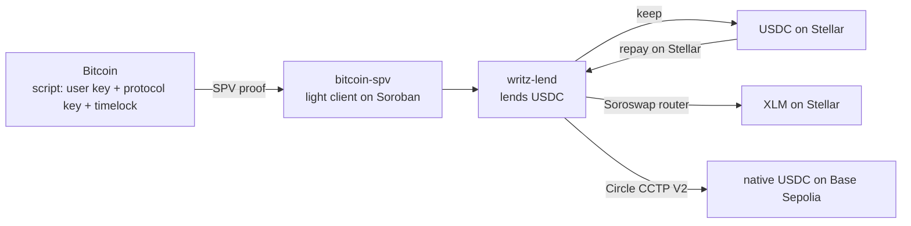

# Writz at HackMeridian 2026: borrow anywhere

Lock native Bitcoin, borrow on Stellar, and receive the loan as the asset you need, on Stellar or on another chain. Your Bitcoin never leaves the Bitcoin network and the loan stays in USDC.

HackMeridian 2026, Lisbon, 25 and 26 October. Scale track, thematic track Stellar Composed: Writz + Soroswap + Circle CCTP V2. Everything runs on testnet.

- **Live app:** [testnet.writz.xyz](https://testnet.writz.xyz)
- **Event work:** pull requests with the [`hackmeridian`](https://github.com/WritzProtocol/writz/pulls?q=label%3Ahackmeridian) label, tracked in [#319](https://github.com/WritzProtocol/writz/issues/319)
- **Prior work ends at:** tag [`hackmeridian-start`](https://github.com/WritzProtocol/writz/tree/hackmeridian-start) (`0a7c65c`, 25 Oct 01:00 Lisbon). Event work is the pull requests merged after it with the `hackmeridian` label, listed below; other work on `main` in the same days (documentation upkeep, an unrelated lender-yield sprint) is not claimed.

## The problem

Borrowing against crypto is a large market: 56.16 billion USD of crypto-collateralized loans were outstanding at the end of Q2 2026 ([Galaxy Research](https://www.galaxy.com/insights/research/)). Yet only about 1% of Bitcoin has been wrapped to reach DeFi (WBTC and cbBTC together hold about 212,000 of 20.1 million BTC, CoinGecko, 24 Oct 2026). Every current route to borrow against Bitcoin asks the holder to trust a custodian, a bridge or a wrapper, and each of those has failed in public: Celsius froze withdrawals in 2022, 64% of the 3.1 billion USD stolen from DeFi in 2022 came from cross-chain bridges (Chainalysis), and WBTC's custody changed hands in 2024.

Writz lets a holder borrow against Bitcoin that stays in a script built from their own key, on the Bitcoin network, verified on Stellar by a Bitcoin light client. At this event we add the other half: receiving the money in the form the borrower actually needs.

## Goals set before the event

Submitted with the Scale application on 21 October, word for word. A goal is ticked only when it is merged and shown on testnet, with its transactions.

- [ ] **1. A new borrow screen where the user sees their Bitcoin deposit verified and the Bitcoin price at which the position would be liquidated.**
  Status: merged: deposit status endpoint [#326](https://github.com/WritzProtocol/writz/pull/326) and [#333](https://github.com/WritzProtocol/writz/pull/333), deposit card [#336](https://github.com/WritzProtocol/writz/pull/336); the borrow screen hands off to the receive step [#321](https://github.com/WritzProtocol/writz/pull/321). Live on testnet once the app is redeployed.
- [ ] **2. Receiving the loan as at least one other Stellar asset (EURC or XLM) instead of USDC.**
  Status: merged: swap [#320](https://github.com/WritzProtocol/writz/pull/320), second step with recovery [#321](https://github.com/WritzProtocol/writz/pull/321), receive-as selector [#336](https://github.com/WritzProtocol/writz/pull/336). XLM, because Circle's EURC has no usable testnet liquidity.
- [ ] **3. Receiving the loan as native USDC on at least one other blockchain.**
  Status: merged: burn on Stellar [#320](https://github.com/WritzProtocol/writz/pull/320), attested by Circle on testnet; the relay that completes the mint on Base Sepolia [#328](https://github.com/WritzProtocol/writz/pull/328), [#335](https://github.com/WritzProtocol/writz/pull/335). A real mint is pending gas for the relay's account.
- [ ] **4. Repaying the loan in USDC on Stellar from the same screen.**
  Status: merged: repay from the loan screen (prior work) with the full-cycle timeline, relayer side [#332](https://github.com/WritzProtocol/writz/pull/332) and screen [#336](https://github.com/WritzProtocol/writz/pull/336).

## Try it

Step-by-step guides with screenshots, written at the event: [docs.writz.xyz/guides/start-here](https://docs.writz.xyz/guides/start-here) (wallets, test funds, borrow, repay and release, lend, troubleshooting).

On [testnet.writz.xyz](https://testnet.writz.xyz) you need:

1. **A Stellar wallet on testnet.** Freighter with the network set to Testnet, funded from [friendbot](https://lab.stellar.org/account/fund). The app adds the USDC trustline for you when you borrow.
2. **A Bitcoin wallet on Signet.** Xverse with the network set to Signet, and coins from [bitcoinsignetfaucet.com](https://bitcoinsignetfaucet.com/) or [signetfaucet.com](https://signetfaucet.com). One faucet payout covers the testnet minimum deposit of 5,000 sats.
3. **Borrow:** lock BTC, wait for one Signet confirmation (about 10 minutes; mainnet requires six), borrow USDC, and choose how to receive it: keep USDC, convert to XLM, or send USDC to an address on Base Sepolia.
4. **Repay** in USDC on Stellar from the same screen.

<!-- EVENT: a pre-verified demo deposit judges can borrow against, if we publish one -->

## Run it locally

Requirements: [Bun](https://bun.sh) and Node 24 (pinned in `.tool-versions`).

```bash
git clone https://github.com/WritzProtocol/writz.git
cd writz/frontend/app
bun install
cp .env.example .env.local   # testnet values are already filled in
bun run dev                  # http://localhost:3000
```

Every screen state, without wallets or network: `NEXT_PUBLIC_UI_MOCK=1 bun run dev`, then open `/dev/scenarios`, and `/dev/receive` for the receive step.

Tests: `bun test src` in `frontend/app`.

### Environment variables used by the event work

All are optional on testnet: unset, they fall back to the testnet values below. On a mainnet build they are empty and the receive options stay off.

| Variable | Testnet default | What it is |
|---|---|---|
| `NEXT_PUBLIC_WRITZ_LEND_ID` | `CABF7VK7F25ZGDLV6EWSAU3NYQYKDQNDSJIISDMDZAUASMSXUADSHZGG` | The lending contract |
| `NEXT_PUBLIC_BITCOIN_SPV_ID` | `CBX23YKCCJMAMBMSCNP6YVKEXUIYK2CTKSR4TQ3RVBPAFYZFVCW7W4EO` | The Bitcoin light client |
| `NEXT_PUBLIC_USDC_TOKEN_ID` | `CBIELTK6YBZJU5UP2WWQEUCYKLPU6AUNZ2BQ4WWFEIE3USCIHMXQDAMA` | Circle testnet USDC (the pool asset, and the asset CCTP burns) |
| `NEXT_PUBLIC_SOROSWAP_ROUTER_ID` | `CCJUD55AG6W5HAI5LRVNKAE5WDP5XGZBUDS5WNTIVDU7O264UZZE7BRD` | Soroswap router |
| `NEXT_PUBLIC_XLM_TOKEN_ID` | `CDLZFC3SYJYDZT7K67VZ75HPJVIEUVNIXF47ZG2FB2RMQQVU2HHGCYSC` | Native XLM Stellar Asset Contract |
| `NEXT_PUBLIC_CCTP_TOKEN_MESSENGER_MINTER_ID` | `CDNG7HXAPBWICI2E3AUBP3YZWZELJLYSB6F5CC7WLDTLTHVM74SLRTHP` | Circle CCTP V2 on Stellar (domain 27) |
| `NEXT_PUBLIC_CCTP_IRIS_URL` | `https://iris-api-sandbox.circle.com` | Circle's attestation service |

The full list for the app is in [`frontend/app/.env.example`](frontend/app/.env.example).

## How it works



1. The borrower locks BTC in a P2WSH script built from their own key, the protocol key and a timelock. The BTC never leaves Bitcoin.
2. The relayer builds an SPV proof; `writz-lend` asks `bitcoin-spv` to verify it on chain and records the position.
3. The borrower borrows USDC from the `writz-lend` pool, up to a 150% collateral ratio.
4. **New at the event:** a second step receives the loan in the chosen form. The debt always stays in USDC on Stellar.
5. Repaying in USDC on Stellar lets the borrower take the BTC back.

## Architecture of the new work

Everything new for the goals runs in the testnet app and the relayer. One contract change was made during the event, for an outside reason: testnet's ledger state rose above its target size, which raised storage rent so much that a new deposit on the previous deployment (`writz-lend` `CCMSOCBV...`, `bitcoin-spv` `CAHHY4S4...`) needed more fee than a transaction can carry. [#340](https://github.com/WritzProtocol/writz/pull/340) makes the storage lifetime of new entries a deployment parameter (shorter on testnet, unchanged on mainnet), and both contracts were redeployed on 25 October. No economic logic, authorization or Bitcoin verification changed.

| Piece | Where | What it does |
|---|---|---|
| Swap to XLM | [`frontend/app/src/lib/receive/swap.ts`](frontend/app/src/lib/receive/swap.ts) | Quotes with `router_get_amounts_out`, quotes again right before signing, then `swap_exact_tokens_for_tokens` with a minimum output (0.5% slippage by default, 5% at most) and a 5 minute deadline |
| Send to Base Sepolia | [`frontend/app/src/lib/receive/cctp.ts`](frontend/app/src/lib/receive/cctp.ts) | Allowance for the TokenMessengerMinter when needed, then `deposit_for_burn` to domain 6 with the EVM address as bytes32, the amount rounded to CCTP's 6 decimals and the fee from Circle's fee API; reads Circle's attestation |
| Second step and recovery | [`frontend/app/src/components/loan/ReceiveStep.tsx`](frontend/app/src/components/loan/ReceiveStep.tsx), [`lib/receive/intent.ts`](frontend/app/src/lib/receive/intent.ts) | After the borrow settles, converts or sends as the borrower chose. If the second signature is declined or fails, the USDC stays in the wallet and the borrower can try again or keep it |
| Mint relay | Relayer, [#309](https://github.com/WritzProtocol/writz/issues/309) | Completes `receiveMessage` on Base Sepolia, so the borrower needs no wallet or gas there |

### Contracts used (testnet)

| Contract | Address |
|---|---|
| `bitcoin-spv` (2026-10-25 redeploy) | `CBX23YKCCJMAMBMSCNP6YVKEXUIYK2CTKSR4TQ3RVBPAFYZFVCW7W4EO` |
| `writz-lend` (2026-10-25 redeploy: 1 confirmation, 5,000 sats minimum) | `CABF7VK7F25ZGDLV6EWSAU3NYQYKDQNDSJIISDMDZAUASMSXUADSHZGG` |
| Circle USDC (SAC) | `CBIELTK6YBZJU5UP2WWQEUCYKLPU6AUNZ2BQ4WWFEIE3USCIHMXQDAMA` |
| Soroswap router | `CCJUD55AG6W5HAI5LRVNKAE5WDP5XGZBUDS5WNTIVDU7O264UZZE7BRD` |
| Soroswap USDC/XLM pair | `CCBX3NZTCQLQFSPG7HBOKL4P2RVPOPVFHDNRTOSCCJWBTPL2GHEH7RQS` |
| CCTP TokenMessengerMinter (Stellar) | `CDNG7HXAPBWICI2E3AUBP3YZWZELJLYSB6F5CC7WLDTLTHVM74SLRTHP` |
| CCTP MessageTransmitterV2 (Base Sepolia) | `0xE737e5cEBEEBa77EFE34D4aa090756590b1CE275` |

## Why it is composed

- **Writz** verifies native Bitcoin on Stellar and lends against it, but pays out only USDC on Stellar.
- **Soroswap** turns that USDC into XLM in one call with a guaranteed minimum.
- **Circle CCTP** moves the same USDC to another chain by burning and minting it, with nothing wrapped and no pool.

Together, Stellar becomes the credit layer for native Bitcoin: the collateral is verified, the loan is held and repaid on Stellar, wherever the money is spent.

## Security and limits

- The receive features call the Soroswap router and Circle's contracts with standard calls. The one contract change during the event ([#340](https://github.com/WritzProtocol/writz/pull/340)) only sets how long new storage entries live; no economic logic, authorization or Bitcoin verification changed.
- The swap and the transfer are a second transaction. If it fails, the borrower keeps the USDC they borrowed; nothing is lost.
- The swap has a minimum output and a deadline; a price move beyond the slippage makes it revert instead of filling badly.
- CCTP burns and mints Circle-native USDC. With the destination caller left open, anyone can complete the mint; our relay does it so the borrower needs nothing on Base Sepolia.
- Testnet only: Signet coins, Circle testnet USDC, testnet CCTP. This testnet deployment accepts 1 confirmation and 5,000 sats; mainnet values are 6 confirmations and 100,000 sats.
- The liquidation price shown is an estimate at the oracle price.
- Repayment is in USDC on Stellar only.

## On-chain evidence

### Full cycle on the 2026-10-25 contracts

Run with the app's own flow code on 25 October; the relayer's `GET /timeline/:txid` returns all eight steps in order.

| Step | Transaction |
|---|---|
| Lock 6,000 sats on Bitcoin Signet (block 327,928) | [`459d084e…`](https://mempool.space/signet/tx/459d084e8516b7965a86a967d7dfc0ec0cb5ca2c5b4cf14445cf55ef8090d6af) |
| Deposit verified on Stellar by `bitcoin-spv`, recorded by `writz-lend` (goal 1) | [`4d2ef33f…`](https://stellar.expert/explorer/testnet/tx/4d2ef33f762b1667e2376a656bee3799dde028e25fde00396bda032505f528de) |
| Borrow 2 USDC | [`14e8056f…`](https://stellar.expert/explorer/testnet/tx/14e8056fe9fb27c5d1edf124cc6156294212b46e58eed7e7bcac5189d2d9b531) |
| Receive 0.5 USDC as 4.654 XLM through the Soroswap router (goal 2) | [`a41d0f83…`](https://stellar.expert/explorer/testnet/tx/a41d0f835747da48c050762694f8c5960ad3c474d2a3989181be955c1fdc00db) |
| Burn 0.5 USDC on Stellar with Circle CCTP V2 (goal 3) | [`fc810e5c…`](https://stellar.expert/explorer/testnet/tx/fc810e5caec892565c9e0e9dcd595dc5e1a244386d55c407839e732b72f23210) |
| Minted as native USDC on Base Sepolia by the relay, about 15 s later (goal 3) | [`0x4bb3e250…`](https://sepolia.basescan.org/tx/0x4bb3e250c27e3d83b5b4af0939a5c99bd8fdf37e0323f0c5b30b2a46cfbf3ab0) |
| Repay in full in USDC on Stellar (goal 4) | [`d7a480bc…`](https://stellar.expert/explorer/testnet/tx/d7a480bc846031c2485c4a4b63835e9ebbfb09b1824fe4df55933dc2c814e10b) |
| BTC released back to the borrower on Signet | [`dcad8ca2…`](https://mempool.space/signet/tx/dcad8ca20018e3dd8b9b57c6c7b7882446df11878d759cc4e635f0378ba00d2c) |

### Earlier checks

| What | Transaction |
|---|---|
| Swap 5 USDC to 46.54 XLM with the app's code | [`523d4d2d…`](https://stellar.expert/explorer/testnet/tx/523d4d2d3e3b84db8ee001bebfe525f12b0760a743f17a368c3c80bad68eea55) |
| Allowance for the CCTP TokenMessengerMinter | [`d1ce1b51…`](https://stellar.expert/explorer/testnet/tx/d1ce1b512a01f714e12b7dc81b2386a826c0457ed95a1b0d960038238c4f7d88) |
| Burn 5 USDC from Stellar to Base Sepolia, attested by Circle in 10 seconds | [`e378cd98…`](https://stellar.expert/explorer/testnet/tx/e378cd985e41b167c4bc9565d397f3f9642c34be2919394b8f0881cc26f78a79) |


## Prior work and event work

Everything before tag `hackmeridian-start` is prior work. The parts the event builds on:

| Prior work | Commit |
|---|---|
| `bitcoin-spv` light client and the coordinated testnet deployment of 2026-10-11 | `c7eba49` |
| Loan page with borrow, repay and release, including the liquidation price | `e5d94b0` (#190) |
| `private-lend` renamed to `writz-lend` | `0a10659` (#287) |
| Borrower flows of the testnet app on `writz-lend` | `63e03bb` (#289) |
| `writz-lend` minimum deposit and confirmations set at deployment | `c626661` (#295) |
| Relayer onboarding faucet limits | `87a4e29` (#302) |

The liquidation price, the confirmation count and the Bitcoin explorer link on the loan screens existed before the event. Event work on goal 1 is the verified-on-Stellar moment, the full set of transaction links and the hand-off from the borrow to the receive step.

Event work, in merge order:

| Pull request | What |
|---|---|
| [#320](https://github.com/WritzProtocol/writz/pull/320) | Receive the loan as XLM through Soroswap or as USDC on Base Sepolia through CCTP |
| [#321](https://github.com/WritzProtocol/writz/pull/321) | Second borrow step to convert or send, with recovery |
| [#324](https://github.com/WritzProtocol/writz/pull/324) | Step-by-step user guides for the testnet app, with screenshots: wallets, test funds, borrow, repay and release, lend, troubleshooting |
| [#326](https://github.com/WritzProtocol/writz/pull/326) | Relayer endpoint `GET /deposit-status/:txid`: confirmations, proof and verification on Stellar for one deposit |
| [#328](https://github.com/WritzProtocol/writz/pull/328) | Relay that completes the CCTP mint on Base Sepolia and pays its gas, so the borrower needs no wallet there |
| [#331](https://github.com/WritzProtocol/writz/pull/331) | Fix: the app counted the resource fee twice when signing contract calls |
| [#333](https://github.com/WritzProtocol/writz/pull/333) | Relayer: submitted and failed deposit stages, read from the app's Stellar transaction |
| [#335](https://github.com/WritzProtocol/writz/pull/335) | Relayer: retries transient relay failures and finds mints through an indexer |
| [#332](https://github.com/WritzProtocol/writz/pull/332) | Relayer: full-cycle loan timeline with explorer links |
| [#337](https://github.com/WritzProtocol/writz/pull/337) | Fix: the relayer counted the resource fee twice when publishing releases |
| [#336](https://github.com/WritzProtocol/writz/pull/336) | App: deposit status card with the verified-on-Stellar seal, receive-as selector and full-cycle timeline |
| [#340](https://github.com/WritzProtocol/writz/pull/340) | Storage lifetimes set at deployment, so a testnet deposit fits in a transaction fee again; both contracts redeployed on testnet |
| [#341](https://github.com/WritzProtocol/writz/pull/341) | App: follows the CCTP relay through retries, pending delivery and failures |
| [#348](https://github.com/WritzProtocol/writz/pull/348) | Fix: the app waits up to ten minutes for the release co-sign and lets the user check again |
| [#349](https://github.com/WritzProtocol/writz/pull/349) | Fix: the relayer serializes its account's transactions and retries a dropped release publish promptly |

## What comes next

- Protecting lenders when a borrower does not repay, without ever holding the Bitcoin: pre-signed liquidation transactions with fixed outputs, enforced on Stellar.
- An independent audit and an audited mainnet launch under caps.
- A Bitcoin verification SDK so other Stellar projects can accept native Bitcoin.

## Team

- Miguel Nieto, captain ([@miguelnietoa](https://github.com/miguelnietoa))
- Sebastián Salazar ([@salazarsebas](https://github.com/salazarsebas))
- Kevin Membreño ([@KevinMB0220](https://github.com/KevinMB0220))
- Josue Araya ([@Josue19-08](https://github.com/Josue19-08)), cofounder, not travelling
