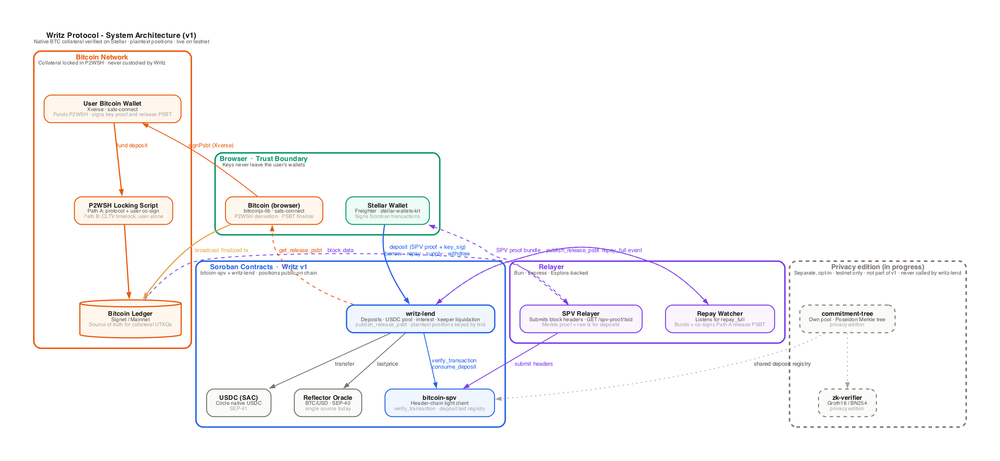
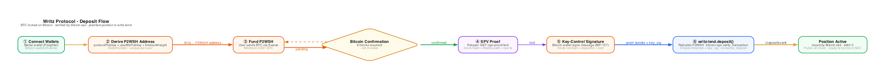
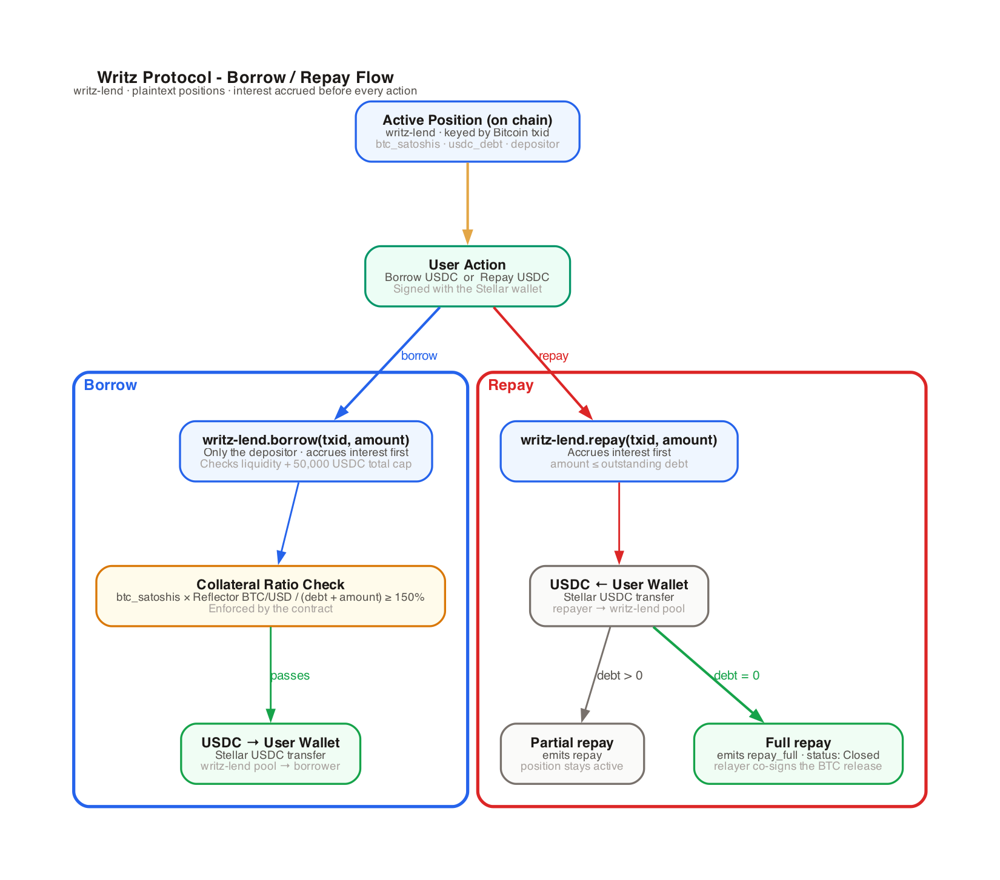
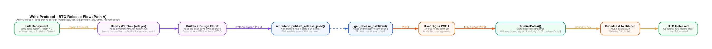
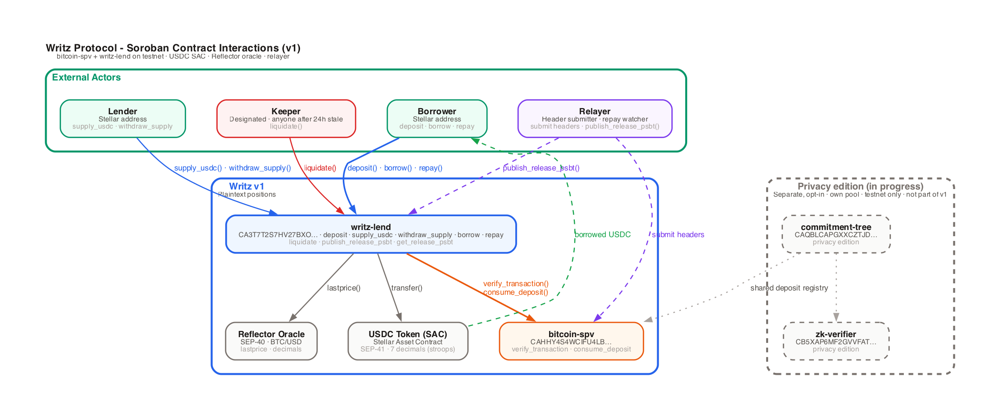
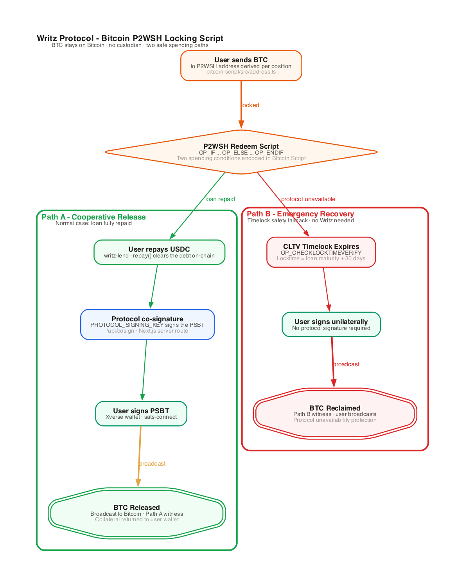

# Writz Protocol

> **Bitcoin was built to be yours. Your loans should be too.**

[](https://github.com/WritzProtocol/writz/actions/workflows/ci.yml?query=branch%3Amain)
[](https://github.com/WritzProtocol/writz/actions)
[](https://stellar.expert/explorer/testnet)
[](LICENSE)

**[Live App](https://writz.xyz)** · **[Docs](https://docs.writz.xyz)** · **[Relayer API](https://api.testnet.writz.xyz)**

**Writz** is a Bitcoin lending protocol on Stellar where the collateral never leaves Bitcoin. Lock real BTC directly from your Bitcoin wallet, borrow USDC on Stellar, and take it back alone if Writz ever disappears.

No bridge. No custodian. No wrapped tokens.

---

## What Makes Writz Different

| | Writz | Every other lending protocol |
|---|---|---|
| **Custodian** | Bitcoin Script is the custodian | A company holds your BTC |
| **BTC** | Native on-chain BTC | Wrapped token (WBTC, tBTC…) |
| **Emergency exit** | CLTV timelock → reclaim alone | Depends on protocol availability |

---

## This Is Not a Whitepaper

As of August 2026, the protocol's two contracts (`bitcoin-spv` and `writz-lend`) are live on Stellar testnet, 623 tests pass, and real Bitcoin transactions have been verified on-chain.

| What | Status |
|---|---|
| Bitcoin SPV verification on Soroban | ✓ Live on testnet |
| `writz-lend` deposit, borrow, repay and release PSBT | ✓ Live on testnet |
| P2WSH locking + co-signed BTC release | ✓ Broadcast on Bitcoin Signet |
| 623 tests across all modules | ✓ All passing |

But a few months ago, it was a whitepaper. Version 1.0 (July 2026) is at [writz.xyz/whitepaper](https://writz.xyz/whitepaper) and archived on Zenodo with the DOI [10.5281/zenodo.23148520](https://doi.org/10.5281/zenodo.23148520).

### Live Testnet Contracts

| Contract | Address | WASM | Tests |
|---|---|---|---|
| `bitcoin-spv` | `CAHHY4S4WCIFU4LBSKBI3IP6A4QYR2COV6EACDEBXGPJFDWBJWGOMCLP` | 12.0 KB | 49 |
| `writz-lend` | `CAVAD3NGIJPDTFLBLJQ5FMLT6UNFE3UFOI3RTQVOVS5RWAD5EDVI5EX4` | 78.8 KB | 118 |

The privacy edition's contracts are also deployed on testnet, separately from the protocol (see [Privacy edition](#privacy-edition-in-progress)):

| Contract | Address | WASM | Tests |
|---|---|---|---|
| `zk-verifier` | `CB5XAP6MF2GVVFATFTVCKVEXUODWWRQP4B3QFDMRTM55REP7N2YMXEUD` | 14.5 KB | 25 |
| `commitment-tree` | `CAQBLCAPGXXCZTJDAJLY7E4PTJYGR6CY4YWH4JSJKFXYIHW3GANP6RFM` | 31.7 KB | 32 |

Full deployment log, init transactions, and verified calls: [`contracts/deployments/testnet.md`](contracts/deployments/testnet.md)

---

## System Architecture



The protocol operates across two blockchains. Bitcoin is the custody layer - BTC never leaves the Bitcoin network. Stellar is the execution layer - SPV verification, loan logic, and USDC flows run on Soroban.

**Four layers, each with a clear boundary:**

1. **Bitcoin Network** - user's BTC wallet locks funds into a P2WSH script. The script enforces two spending conditions; no third party can move the funds.
2. **Backend Services** - a stateless SPV Relayer watches Bitcoin blocks and assembles proof bundles for Soroban, and a repay watcher co-signs the release PSBT once a loan is fully repaid.
3. **Soroban Contracts** - `bitcoin-spv` verifies Bitcoin transactions cryptographically; `writz-lend` registers deposits and issues, accrues and settles USDC loans.
4. **Browser** - keys stay on the user's device. The Bitcoin wallet signs the key-control proof and the release transaction; the Stellar wallet signs Soroban transactions.

Positions, amounts and collateral are public on chain, like any other lending market.

---

## How It Works

### 1 - Deposit & Borrow



1. User connects their Bitcoin wallet (Xverse) and a Stellar wallet (Freighter) to the Writz UI.
2. The frontend derives a unique P2WSH address for this deposit (user public key + protocol public key + timelock).
3. User sends BTC to that address on Bitcoin. The script is now live on-chain.
4. After 6 confirmations, the SPV Relayer assembles a proof bundle: raw transaction, block headers, and Merkle inclusion path.
5. The user signs a key-control message with the Bitcoin key in the script, and calls `writz-lend.deposit` with the proof bundle and the signature.
6. `writz-lend` rebuilds the expected P2WSH script, asks `bitcoin-spv` to verify the transaction's inclusion and confirmations cryptographically - no oracle, no trust - and records the position.
7. The user can now borrow up to 66% of BTC value in USDC from the `writz-lend` pool.

### 2 - Borrow & Repay



`writz-lend.borrow` checks the post-borrow collateral ratio against the BTC/USD oracle price and refuses anything below 150%. Interest accrues on a utilization-based curve. `repay` accepts partial or full repayment; a full repayment closes the position and emits a `repay_full` event.

### 3 - BTC Release



When the loan is fully repaid, the relayer's repay watcher builds the release PSBT (Partially Signed Bitcoin Transaction), co-signs it with the protocol key, and publishes it on `writz-lend` with `publish_release_psbt`, so it can be fetched even if the rest of the Writz stack is down. The user countersigns with their Bitcoin wallet and broadcasts. BTC arrives back in their wallet. The protocol never held custody at any point.

---

## Privacy edition (in progress)

Writz v1 has no privacy layer: positions, amounts and collateral are public on chain. Privacy is not part of the protocol. It is being designed as a separate, opt-in edition with its own contracts (today `commitment-tree`, `zk-verifier` and the Circom circuits in [`circuits/`](circuits/), on testnet only), its own pool, its own audit and its own trusted-setup ceremony. It is planned for after v1 is live on mainnet, on its own subdomain, and has no date. Users who do not want privacy never interact with it. Design notes: [Privacy edition (in progress)](docs/how-it-works/privacy-edition.md).

---

## Smart Contract Architecture



| Contract | Purpose | Depends on |
|---|---|---|
| `bitcoin-spv` | SHA256d, PoW validation, checkpoint-anchored difficulty check, Merkle inclusion, block header chain, deposit txid registry | - |
| `writz-lend` | Deposit registration, USDC lending pool (supply, withdraw, borrow, repay), interest rate model, keeper liquidation, release PSBT publication; plaintext positions | `bitcoin-spv`, USDC, Reflector oracle |

**Interest rate model** - kinked curve: base rate + linear slope up to 75% utilization, then a steep slope to discourage over-borrowing. Protocol captures the spread between borrow and supply rates.

The privacy edition's `commitment-tree` and `zk-verifier` contracts are not called by `writz-lend` and are not part of the v1 protocol. Both lending contracts consume a deposit txid in the shared `bitcoin-spv` registry, so the same Bitcoin output cannot back two positions; see `docs/security/security-model.md` for how this also closes the Merkle duplicate-leaf ambiguity (CVE-2012-2459-class) at the deposit layer.

---

## Bitcoin Script Design



The BTC locking mechanism lives entirely on Bitcoin. The P2WSH redeem script encodes two spending paths:

```
OP_IF
  <protocol_pubkey> OP_CHECKSIGVERIFY
  <user_pubkey>     OP_CHECKSIG
OP_ELSE
  <locktime>        OP_CHECKLOCKTIMEVERIFY OP_DROP
  <user_pubkey>     OP_CHECKSIG
OP_ENDIF
```

**Path A - Cooperative release (normal case):** Both the protocol and user sign. Triggered when the loan is repaid. The Soroban contract issues the co-signature only after verifying repayment on-chain.

**Path B - Emergency recovery (timelock):** After a predefined locktime (loan maturity + 30 days), the user can spend without any protocol involvement. If Writz disappears, the user's funds are never locked forever.

See [`bitcoin-script/`](bitcoin-script/) for the full P2WSH builder, address derivation, and PSBT signing toolkit.

---

## Products

| Product | Description | Status |
|---|---|---|
| **Writz Lend** | Deposit BTC as collateral → borrow USDC | Phase 1 - testnet ✓ |
| **Dark Swap** | Convert BTC to USDC directly · no exchange · no visible order | Phase 3 - planned |
| **BTC Savings** | BTC collateral + USDC auto-routed to highest-yield Stellar pools | Phase 3 - planned |
| **ZK Proof of Reserve** | Prove BTC holdings without revealing wallets or amounts · B2B SaaS | Phase 3 - planned |

The **Bitcoin SPV SDK** is also open infrastructure. Any Stellar protocol that needs to verify a Bitcoin transaction on-chain can use `bitcoin-spv` with one call. Writz charges a per-verification fee.

---

## Repository Structure

```
writz/
├── contracts/               # Soroban smart contracts (Rust)
│   ├── contracts/
│   │   ├── bitcoin-spv/     # SHA256d · PoW · Merkle inclusion · block headers
│   │   ├── writz-lend/      # Deposits · USDC pool · interest model · liquidation
│   │   ├── zk-verifier/     # Privacy edition (in progress) · Groth16 BN254
│   │   └── commitment-tree/ # Privacy edition (in progress) · Poseidon Merkle tree
│   └── deployments/
│       └── testnet.md       # Live addresses · tx hashes · verified calls
│
├── circuits/                # Privacy edition circuits (Circom 2.2.3 + snarkjs)
│   ├── src/
│   │   ├── deposit.circom
│   │   ├── borrow_repay.circom
│   │   ├── liquidation.circom
│   │   └── merkle.circom
│   └── keys/                # Verification keys (committed to repo)
│
├── relayer/                 # SPV Relayer service (TypeScript · Express · Bun)
│   └── src/
│       ├── routes/proof.ts  # GET /spv-proof/:txid
│       └── bitcoin/         # Esplora client · header fetching · proof assembly
│
├── bitcoin-script/          # Bitcoin locking script toolkit (TypeScript)
│   └── src/
│       ├── script.ts        # P2WSH builder
│       ├── address.ts       # Address derivation (testnet / mainnet)
│       ├── spend.ts         # Path A/B PSBT signing
│       └── keys.ts          # Key management
│
├── frontend/                # Next.js web app (React 19 · TypeScript · Tailwind)
│   └── src/
│       ├── components/      # DepositFlow · PositionDashboard · LenderPanel
│       ├── lib/flows/       # deposit · borrow · repay · release · lend
│       └── lib/position/    # Local cache of positions read from writz-lend
│
├── packages/
│   └── commitment-tree/     # Generated TypeScript bindings for commitment-tree
│
├── scripts/
│   ├── deploy/              # Deployment scripts · deploy_stack.mjs · e2e_local.mjs
│   └── diagrams/            # Graphviz architecture diagrams (Python)
│
└── docs/                    # Full documentation (Mintlify)
```

---

## Tech Stack

| Layer | Technology | Notes |
|---|---|---|
| Smart contracts | Soroban · Rust | Protocol 26 · `soroban-sdk = "26"` |
| Bitcoin scripting | P2WSH (Phase 1) → Taproot (Phase 3) | `bitcoinjs-lib` · `ecpair` |
| Bitcoin wallets | Xverse · sats-connect | PSBT standard |
| Frontend | Next.js 16 · React 19 · TypeScript | App Router · Tailwind CSS 4 |
| Stellar wallets | Stellar Wallets Kit · Pollar | Freighter · Lobstr · email and social login on testnet |
| Relayer runtime | Bun · Express.js | Alpine Docker · Esplora-backed |
| Privacy edition (in progress) | Circom 2.2.3 · snarkjs · Groth16 · Poseidon | BN254 via Protocol 26 host functions; not part of v1 |
| CI | GitHub Actions | 4 parallel jobs · all tests must pass |

---

## Quick Start

### Prerequisites

```bash
# Rust with Soroban WASM target
rustup target add wasm32v1-none
cargo install stellar-cli --locked --version 27  # or later

# Node.js / Bun (for relayer, bitcoin-script, circuits, frontend)
node --version  # >= 20
bun --version   # >= 1.1

# For the privacy edition's ZK circuits only.
# circom 2.x is a Rust binary - do NOT `npm install -g circom`, which installs
# the legacy 1.x package and cannot compile `pragma circom 2.0.0`. Grab the
# release binary (CI pins v2.2.3) or build it with cargo:
curl -fL -o ~/.local/bin/circom \
  https://github.com/iden3/circom/releases/download/v2.2.3/circom-linux-amd64
chmod +x ~/.local/bin/circom   # macOS: use circom-macos-amd64
circom --version               # expect: circom compiler 2.2.3
# snarkjs needs no global install - it is already a dependency of circuits/
```

### Run All Tests

Each module has its own toolchain - there is no unifying root build, and the
package manager is **not** the same everywhere. Run them from the repo root:

```bash
# 1. Soroban contracts - 263 tests
cd contracts && cargo test

# 2. Bitcoin script toolkit - 60 tests (Bun's own test runner)
cd ../bitcoin-script && bun install && bun test

# 3. Relayer service - 248 tests
#    Deps install with Bun, but the suite itself is Jest (ts-jest), so it must
#    be run through the package script - plain `bun test` picks Bun's runner
#    instead and fails. The relayer also imports the local @writz/* packages
#    via their built dist/ output, so build those first.
cd ../packages/commitment-tree && bun install
cd ../../bitcoin-script && bun run build
cd ../relayer && bun install && bun run test

# 4. Privacy edition ZK circuits - 52 tests (npm + Jest; needs circom on PATH)
cd ../circuits && npm install && npm test
```

All 623 tests pass. If anything fails, [open an issue](https://github.com/WritzProtocol/writz/issues).

### Local End-to-End (Privacy Edition Contracts)

Deploys all four contracts on a local network and runs deposit → borrow → repay → release through the privacy edition's `commitment-tree` with real Groth16 proofs, plus the closed attacks (including the cross-pool duplicate-deposit check against `writz-lend`):

```bash
docker run -d --rm --name writz-local-stellar -p 8000:8000 \
  stellar/quickstart:latest --local --enable rpc
(cd contracts && cargo build --release --target wasm32v1-none --locked)
(cd circuits && npm ci && npm run compile && npm run setup:dev)
(cd scripts/deploy && bun install)
node scripts/deploy/e2e_local.mjs
```

No testnet key needed. The [Testnet Runbook](docs/developers/runbook.md) covers the manual Signet walkthrough for the Bitcoin half.

### Frontend Dev Server

```bash
cd frontend/app
cp .env.example .env.local
# Fill in NEXT_PUBLIC_* contract addresses from contracts/deployments/testnet.md
# Set NEXT_PUBLIC_RELAYER_URL=https://api.testnet.writz.xyz
bun install && bun dev
# → http://localhost:3000
```

The testnet app is also live at **[writz.xyz](https://writz.xyz)**.

### Generate Architecture Diagrams

```bash
pip install graphviz
python3 scripts/diagrams/render-all.py
# → docs/diagrams/output/*.png + *.svg
```

---

## Test Coverage

| Module | Language | Tests | How to run |
|---|---|---|---|
| `bitcoin-spv` contract | Rust | 47 | `cd contracts && cargo test -p bitcoin-spv` |
| `zk-verifier` contract | Rust | 18 | `cd contracts && cargo test -p zk-verifier` |
| `commitment-tree` contract | Rust | 18 | `cd contracts && cargo test -p commitment-tree` |
| `writz-lend` contract | Rust | 63 | `cd contracts && cargo test -p writz-lend` |
| Relayer service | TypeScript | 48 | `cd relayer && bun run test` |
| Bitcoin script toolkit | TypeScript | 60 | `cd bitcoin-script && bun test` |
| ZK circuits | Circom / JS | 20 | `cd circuits && npm test` |
| **Total** | | **274** | |

---

## Business Model

| Revenue Stream | Mechanism |
|---|---|
| **Lending spread** | Borrow rate minus supply rate on Writz Lend |
| **Swap fees** | Basis points on each Dark Swap conversion |
| **SPV API fees** | Per-verification or subscription for third-party Stellar protocol integrations |
| **Proof of Reserve SaaS** | Monthly subscription for enterprise B2B customers |
| **Insurance fund** | % of all protocol fees auto-routed to an on-chain reserve |

---

## Security

### Risk Model

| Risk | Mitigation |
|---|---|
| Bitcoin reorg | Require 6 confirmations before deposit is recognized |
| P2WSH script bug | Formal review; emergency timelock protects users regardless |
| Protocol key compromise | MPC / HSM co-signing key; key rotation roadmap |
| SPV contract exploit | External audit; stateless approach minimizes attack surface |
| Oracle manipulation | Median of multiple price feeds (Pyth + DIA) |
| Mass liquidation (BTC crash) | Conservative 150% collateral ratio; open liquidation keeps keepers competitive |

### Audit Roadmap

| Scope | Timing |
|---|---|
| Soroban contracts (`bitcoin-spv`, `writz-lend`) | Before mainnet |
| Bitcoin P2WSH scripting | Internal, ongoing; external review before mainnet |
| Privacy edition circuits and contracts | Its own audit, before that edition launches |

Mainnet launch is gated on zero open critical/high findings from the external contract audit.

To report a security issue: open a private [GitHub Security Advisory](https://github.com/WritzProtocol/writz/security/advisories/new). Full policy, response targets, and safe harbour in [`SECURITY.md`](SECURITY.md); rewards and severity bands in [`docs/security/bug-bounty.md`](docs/security/bug-bounty.md).

---

## Documentation

Full documentation lives in [`docs/`](docs/) and is published at **[docs.writz.xyz](https://docs.writz.xyz)**:

**Start here:**
- [Whitepaper](https://writz.xyz/whitepaper) - The technical paper (v1.0, July 2026): stateless SPV and the lending market. The Groth16 position privacy it describes is now planned as a separate edition, in progress. DOI [10.5281/zenodo.23148520](https://doi.org/10.5281/zenodo.23148520).
- [What is Writz?](docs/introduction/what-is-writz.md) - Plain English. No jargon. 5 minutes.
- [The Problem](docs/introduction/the-problem.md) - Why public DeFi breaks BTC holders.
- [How Writz Works](docs/introduction/how-writz-works.md) - Full flow for any reader.
- [Why Stellar, Why Now](docs/introduction/why-stellar-why-now.md) - The strategic window.

**Products:**
- [Writz Lend](docs/products/writz-lend.md) - Step-by-step user guide.
- [ZK Proof of Reserve](docs/products/zk-proof-of-reserve.md) - The B2B enterprise product.

**How it works (technical):**
- [Bitcoin Side](docs/how-it-works/bitcoin-side.md) - P2WSH locking, spending paths, CLTV.
- [SPV Verification](docs/how-it-works/spv-verification.md) - Trustless Bitcoin tx verification on Soroban.
- [Stellar Side](docs/how-it-works/stellar-side.md) - Contracts, interest model, USDC pool.
- [Privacy edition (in progress)](docs/how-it-works/privacy-edition.md) - Design of the separate, opt-in privacy edition. Not part of v1.

**Developers:**
- [Build on Writz](docs/developers/integrate.md) - Prove a Bitcoin transaction from your contract or app, on testnet.
- [For AI Agents](docs/developers/for-ai-agents.md) - Exact IDs, signatures and verified examples for coding agents.
- [Quick Start](docs/developers/quick-start.md) - Clone, build, test, deploy.
- [SPV SDK](docs/developers/spv-sdk.md) - Free Bitcoin verification for any Stellar protocol.
- [Contract Reference](docs/developers/contract-reference.md) - All public interfaces.

**Security:**
- [Security Model](docs/security/security-model.md) - What Writz protects and how.
- [Audits](docs/security/audits.md) - Audit roadmap and status.

**Roadmap:**
- [Vision](docs/roadmap/vision.md) - Where Writz is going by 2028.

---

## Contributing

1. Fork the repo and create a branch from `main`.
2. Run the full test suite before opening a PR - all 623 tests must pass.
3. For new features, add tests. For bug fixes, add a regression test.
4. Open a PR with a clear description of what changed and why.

See [`docs/developers/contribution-guide.md`](docs/developers/contribution-guide.md) for detailed guidelines.

---

## Get Involved

| You are | Start here |
|---|---|
| **BTC holder** who wants to borrow USDC against BTC | [Writz Lend →](docs/products/writz-lend.md) |
| **Developer** who wants to build on the protocol | [Build on Writz →](docs/developers/integrate.md) |
| **Stellar protocol** that needs Bitcoin verification | [SPV SDK →](docs/developers/spv-sdk.md) |
| **Institution** exploring ZK Proof of Reserve | [ZK PoR →](docs/products/zk-proof-of-reserve.md) |

---

## License

Apache License 2.0 - see [`LICENSE`](LICENSE).
