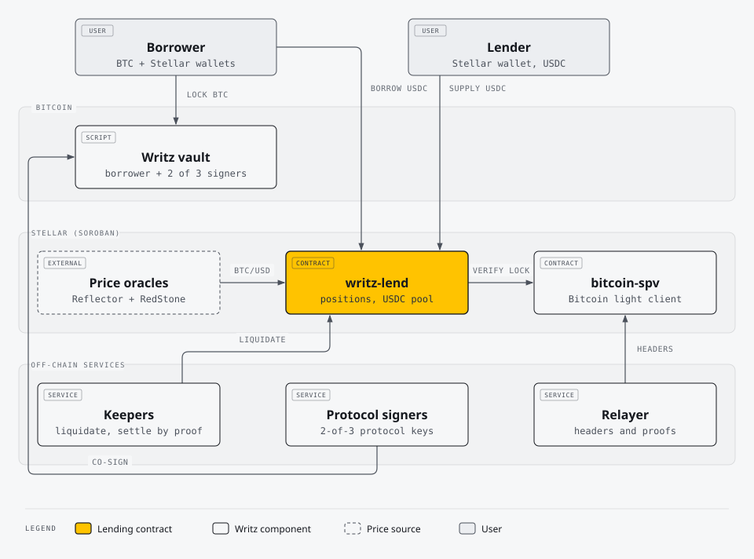
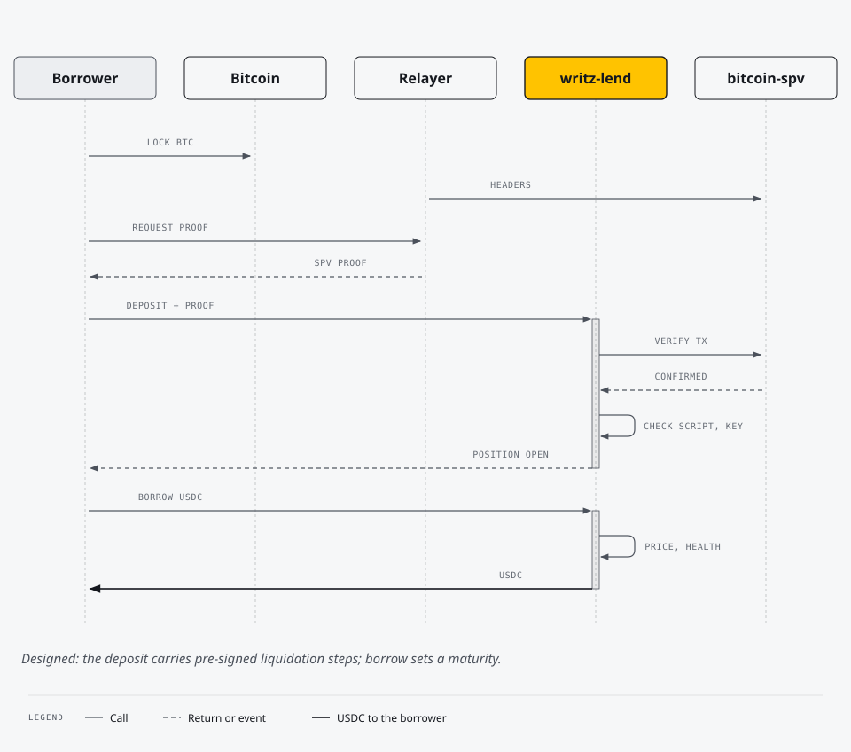
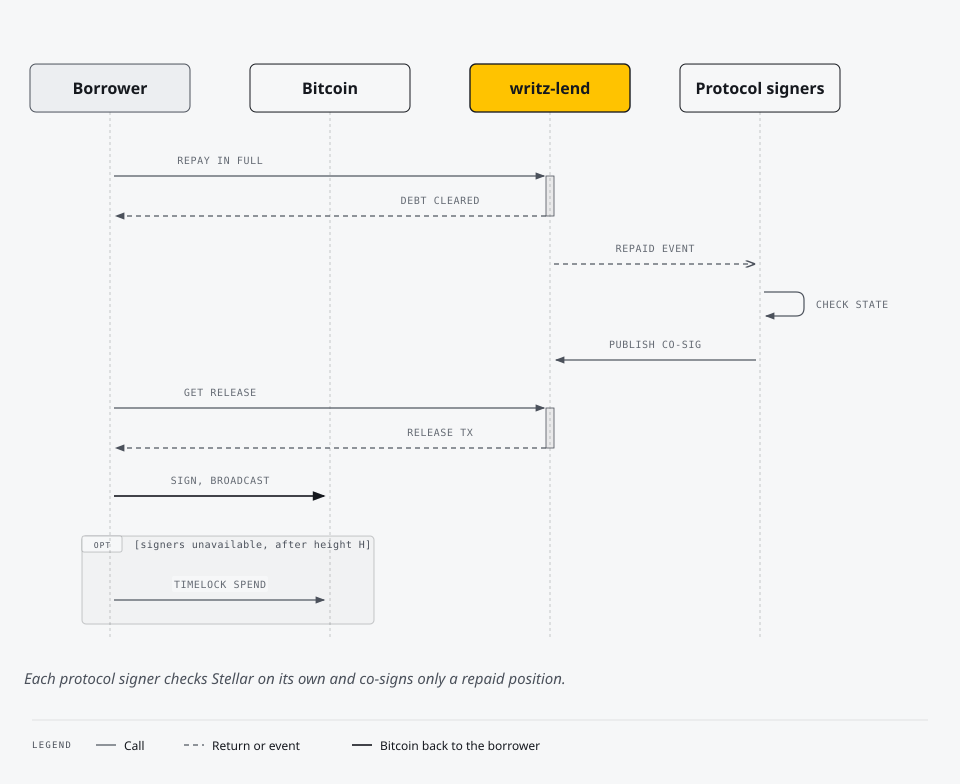
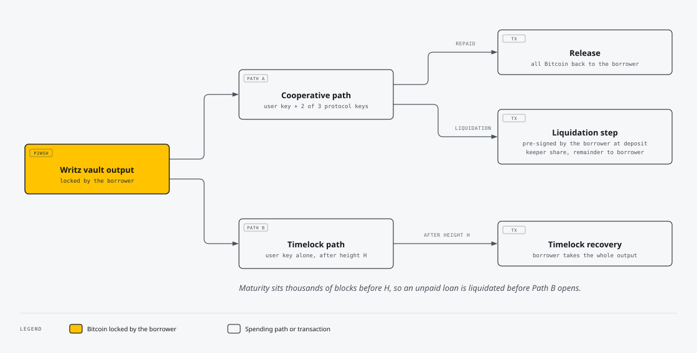

<p align="center">
  <a href="https://writz.xyz/?utm_source=github&utm_medium=readme">
    <picture>
      <source media="(prefers-color-scheme: dark)" srcset="docs/brand/writz-lockup-white.svg">
      
    </picture>
  </a>
</p>

<h3 align="center">Bitcoin was built to be yours. Your loans should be too.</h3>

<p align="center">
  Borrow USDC on Stellar without selling your Bitcoin. Your BTC never leaves the Bitcoin network.<br>
  No bridge. No custodian. No wrapped tokens.
</p>

<p align="center">
  <a href="https://github.com/WritzProtocol/writz/actions/workflows/ci.yml?query=branch%3Amain"></a>
  <a href="https://stellar.expert/explorer/testnet/contract/CD3BRE32LDNDHAEVI6H35UC3NIRREW5BLH64AZMHSQY3LEKYDLKYWBXS"></a>
  <a href="https://www.npmjs.com/package/@writz/sdk"></a>
  <a href="https://crates.io/crates/writz-spv-client"></a>
  <a href="https://github.com/WritzProtocol/writz/blob/main/LICENSE"></a>
</p>

<p align="center">
  <a href="https://docs.writz.xyz/guides/borrow"><b>Borrow on testnet</b></a> &nbsp;·&nbsp;
  <a href="https://docs.writz.xyz/guides/lend"><b>Lend on testnet</b></a> &nbsp;·&nbsp;
  <a href="#build-on-writz"><b>Build with the SPV SDK</b></a>
  <br>
  <a href="https://testnet.writz.xyz/?utm_source=github&utm_medium=readme">Testnet app</a> &nbsp;·&nbsp;
  <a href="https://docs.writz.xyz">Documentation</a> &nbsp;·&nbsp;
  <a href="https://writz.xyz/?utm_source=github&utm_medium=readme">Website</a> &nbsp;·&nbsp;
  <a href="https://discord.gg/zDa4xRN9Xe">Discord</a> &nbsp;·&nbsp;
  <a href="https://x.com/WritzProtocol">X</a>
</p>

> [!IMPORTANT]
> **Status: testnet only.** Writz runs on Stellar testnet with Bitcoin Signet coins. It has not been externally audited, and no Writz contract is deployed on Stellar mainnet. Mainnet is planned for Q2 to Q3 2027. Do not send real funds.

---

**Writz** is a Bitcoin lending protocol on Stellar where the collateral never leaves Bitcoin. Lock native BTC directly from your Bitcoin wallet, borrow USDC on Stellar, and, if Writz ever disappears, take the BTC back alone once the timelock chosen at deposit has passed.

The BTC sits in a Bitcoin script that the borrower and the protocol can only spend from together, and that the borrower can spend from alone after the timelock. A Bitcoin light client written as a Soroban contract verifies the deposit on Stellar with proof-of-work and a Merkle proof, against a header chain anchored to a public checkpoint, so no oracle, bridge or federation attests to the deposit. USDC lenders fund the pool and earn the interest borrowers pay.

## Contents

- [The problem](#the-problem)
- [How Writz solves it](#how-writz-solves-it)
- [What you trust today](#what-you-trust-today)
- [Status](#status)
- [System architecture](#system-architecture)
- [Loan lifecycle](#loan-lifecycle)
- [Bitcoin script design](#bitcoin-script-design)
- [Smart contracts](#smart-contracts)
- [Security](#security)
- [Build on Writz](#build-on-writz)
- [Products and business model](#products-and-business-model)
- [Developing in this repository](#developing-in-this-repository)
- [Documentation](#documentation)
- [Get involved](#get-involved)

---

## The problem

Borrowing against Bitcoin in DeFi almost always means handing it to someone else first. Wrapped BTC such as WBTC is backed by coins held by custodians. Threshold networks such as tBTC, and pegs such as Stacks sBTC, rely on a signer set that could move the coins if enough members acted together. The alternative is to sell the BTC or bridge it to another chain, which adds bridge contracts, peg mechanisms and the custody behind them.

Writz is built for holders who will not give up custody or trust a bridge in order to borrow. Read more in [The problem](https://docs.writz.xyz/introduction/the-problem).

## How Writz solves it

| | Writz | Custodial lenders and wrapped-BTC protocols |
|---|---|---|
| **Who holds the BTC** | A Bitcoin script; neither Writz nor the borrower can move it alone before the timelock | A custodian or a signer set |
| **What the collateral is** | Native BTC on the Bitcoin chain | A wrapped token (WBTC, tBTC and similar) |
| **How the deposit is proven** | Bitcoin light client on Soroban: proof-of-work, difficulty and Merkle inclusion | The issuer or bridge attests to it |
| **If the protocol disappears** | CLTV timelock: the borrower reclaims the BTC alone after it passes | Depends on the protocol or custodian staying available |

Stellar is the execution layer because Circle issues USDC natively there, neither bridged nor wrapped, and Soroban's compute budget fits a full Bitcoin header light client written in Rust. Read more in [Why Stellar, why now](https://docs.writz.xyz/introduction/why-stellar-why-now).

---

## What you trust today

Writz removes the custodian, not every assumption. This is what each party can and cannot do on the current testnet deployment, as enforced by the contracts.

| Party | Can | Cannot |
|---|---|---|
| **Protocol co-signing key** (Bitcoin) | Refuse to co-sign a release, so the borrower waits for the timelock. A deposit's timelock can be up to 105,000 blocks (about two years) after it confirms | Move BTC without the borrower's key |
| **Relayer** (Stellar account) | Submit Bitcoin headers (the only submitter on testnet); co-sign and publish the release transaction. The rule "release only after full repayment" is enforced by the relayer, not by the contract | Move BTC without the borrower's key; rewrite stored headers |
| **`writz-lend` admin** | Change the price source, the `bitcoin-spv` address, the keeper, the relayer, the borrow cap and other limits; pause new loans. Changes take effect immediately | Change contract code (there is no upgrade path); move BTC |
| **`bitcoin-spv` admin** | Set the checkpoint once at deployment; choose the header submitter and which lending contracts may consume deposits | Rewrite stored headers or the checkpoint once set |

- **Signet headers are trusted.** Signet blocks are authenticated by a signature the contract does not verify, so on testnet the header source is the Writz relayer. On mainnet, proof-of-work at real difficulty is the security and header submission can be open to anyone.
- **The relayer is a liveness dependency.** If no header arrives for 6 hours, new borrows and liquidations pause, and a repaid loan's release waits for the relayer. The BTC is never stuck: after the timelock the borrower spends it alone.
- **Liquidation moves no BTC today.** A liquidator repays the debt and receives a bonus in USDC; the BTC stays in its script until the timelock. Debt that nobody liquidates is a lender risk, limited today by a 50,000 USDC total borrow cap that the admin can change.

Planned before mainnet: Bitcoin transactions the borrower pre-signs at deposit to settle a default on Bitcoin, a 2-of-3 protocol signer set, 2-of-3 admin accounts, several independent relayers with open submission, a second price source (RedStone) and an external audit. The full analysis is in the [Security model](https://docs.writz.xyz/security/security-model) and [SPV vs wrapped Bitcoin](https://docs.writz.xyz/security/spv-vs-wrapped).

---

## Status

Both protocol contracts are live on Stellar testnet, and Bitcoin Signet deposits have been verified on chain.

| What | Status |
|---|---|
| Bitcoin SPV verification on Soroban | Live on testnet |
| `writz-lend` deposit, borrow, repay and release PSBT | Live on testnet |
| P2WSH locking and co-signed BTC release | Broadcast on Bitcoin Signet |
| USDC lenders earn the interest borrowers pay ([evidence](https://docs.writz.xyz/developers/evidence/lender-yield-testnet)) | Live on testnet |
| Receive the loan as EURC or PYUSD (Soroswap) or as USDC on Base Sepolia (Circle CCTP V2) | Live on testnet |

The project started as a whitepaper (v1.0, July 2026, DOI [10.5281/zenodo.23148520](https://doi.org/10.5281/zenodo.23148520)). The current design supersedes it in places; the [technical architecture](https://docs.writz.xyz/architecture/technical-overview) is the reference, and sets out what is live and what is designed.

### Live testnet contracts

| Contract | Address | WASM |
|---|---|---|
| `bitcoin-spv` | [`CBX23YKCCJMAMBMSCNP6YVKEXUIYK2CTKSR4TQ3RVBPAFYZFVCW7W4EO`](https://stellar.expert/explorer/testnet/contract/CBX23YKCCJMAMBMSCNP6YVKEXUIYK2CTKSR4TQ3RVBPAFYZFVCW7W4EO) | 45.2 KB |
| `writz-lend` | [`CD3BRE32LDNDHAEVI6H35UC3NIRREW5BLH64AZMHSQY3LEKYDLKYWBXS`](https://stellar.expert/explorer/testnet/contract/CD3BRE32LDNDHAEVI6H35UC3NIRREW5BLH64AZMHSQY3LEKYDLKYWBXS) | 94.6 KB |

Any other `bitcoin-spv` or `writz-lend` ID is superseded. The contracts have been redeployed several times on testnet; the full history, init transactions and verified calls are in [`contracts/deployments/testnet.md`](https://github.com/WritzProtocol/writz/blob/main/contracts/deployments/testnet.md), and the machine-readable IDs in [`testnet.json`](https://github.com/WritzProtocol/writz/blob/main/contracts/deployments/testnet.json).

---

## System architecture

<picture>
  <source media="(prefers-color-scheme: dark)" srcset="docs/diagrams/system-architecture-dark.svg">
  
</picture>

The diagrams show the protocol as designed; what runs on testnet today and what is planned before mainnet are in the [technical architecture](https://docs.writz.xyz/architecture/technical-overview).

The protocol operates across two blockchains. Bitcoin is the custody layer: BTC never leaves the Bitcoin network. Stellar is the execution layer: SPV verification, loan logic and USDC flows run on Soroban.

1. **Bitcoin network.** The user's BTC wallet locks funds into a P2WSH script with two spending conditions.
2. **Backend services.** An SPV relayer watches Bitcoin blocks, submits their headers to the `bitcoin-spv` light client and assembles transaction proofs against them; a repay watcher co-signs the release PSBT once a loan is fully repaid.
3. **Soroban contracts.** `bitcoin-spv` verifies Bitcoin transactions cryptographically; `writz-lend` registers deposits and issues, accrues and settles USDC loans.
4. **Browser.** Keys stay on the user's device. The Bitcoin wallet signs the key-control proof and the release transaction; the Stellar wallet signs Soroban transactions.

Positions, amounts and collateral are public on chain, like any other lending market.

---

## Loan lifecycle

### 1. Deposit and borrow

<picture>
  <source media="(prefers-color-scheme: dark)" srcset="docs/diagrams/deposit-and-borrow-dark.svg">
  
</picture>

1. The user connects a Bitcoin wallet (Xverse) and a Stellar wallet (Varial, formerly Freighter, or xBull, Lobstr, Albedo, Rabet). On testnet, an email or social sign-in with a Signet test key kept in the browser replaces both.
2. The frontend derives a unique P2WSH address for this deposit from the user public key, the protocol public key and the timelock.
3. The user sends BTC to that address on Bitcoin.
4. After the required confirmations (1 on testnet, 6 planned for mainnet), the SPV relayer assembles a proof bundle: raw transaction, block headers and Merkle inclusion path.
5. The user signs a key-control message with the Bitcoin key in the script, and calls `writz-lend.deposit` with the proof bundle and the signature.
6. `writz-lend` rebuilds the expected P2WSH script, asks `bitcoin-spv` to verify the transaction's inclusion and confirmations against its stored header chain, and records the position.
7. The user borrows USDC from the `writz-lend` pool while keeping a collateral ratio of at least 150% (debt up to about two thirds of the BTC value), and can keep the USDC, swap it through Soroswap (EURC, PYUSD), or send it as native USDC to Base Sepolia with Circle CCTP V2.

### 2. Repay and liquidation

`writz-lend.borrow` checks the post-borrow collateral ratio against the BTC/USD oracle price and refuses anything below 150%, or a borrow when the position's Bitcoin timelock is less than 4,320 blocks above the `bitcoin-spv` tip. Interest accrues on a utilization-based curve. `repay` accepts partial or full repayment; a full repayment closes the position and emits a `repay_full` event.

Below a 120% collateral ratio a position can be liquidated. A designated keeper calls `liquidate`, repays the debt and receives a 10% USDC bonus from the protocol reserve, capped at what the reserve holds; if the keeper has been inactive for 24 hours, anyone may call it. No BTC moves in a liquidation today, see [What you trust today](#what-you-trust-today) and [Liquidation](https://docs.writz.xyz/products/writz-lend#liquidation).

### 3. BTC release

<picture>
  <source media="(prefers-color-scheme: dark)" srcset="docs/diagrams/repay-and-release-dark.svg">
  
</picture>

When the loan is fully repaid, the relayer's repay watcher builds the release PSBT (Partially Signed Bitcoin Transaction), co-signs it with the protocol key and publishes it on `writz-lend` with `publish_release_psbt`, so once published it can be fetched even if the rest of the Writz stack is down. The user countersigns with their Bitcoin wallet and broadcasts. The protocol never holds custody at any point.

### Lending USDC

Lenders supply USDC to the same `writz-lend` pool and earn the interest borrowers pay, minus the 15% protocol fee. The rate is variable and zero while nothing is borrowed. See [For USDC lenders](https://docs.writz.xyz/products/writz-lend#for-usdc-lenders-earn) and the [lending guide](https://docs.writz.xyz/guides/lend).

---

## Bitcoin script design

<picture>
  <source media="(prefers-color-scheme: dark)" srcset="docs/diagrams/vault-spending-paths-dark.svg">
  
</picture>

The P2WSH redeem script encodes two spending paths:

```text
OP_IF
  <protocol_pubkey> OP_CHECKSIGVERIFY
  <user_pubkey>     OP_CHECKSIG
OP_ELSE
  <locktime>        OP_CHECKLOCKTIMEVERIFY OP_DROP
  <user_pubkey>     OP_CHECKSIG
OP_ENDIF
```

**Path A, cooperative release (normal case).** The protocol and the user both sign. The relayer's repay watcher co-signs only after `writz-lend` records full repayment, and publishes the PSBT on chain with `publish_release_psbt`.

**Path B, emergency recovery (timelock).** After the timelock height chosen at deposit, the user spends alone, with no protocol involvement. The timelock must be 1,008 to 105,000 blocks above the deposit block; `borrow` requires it to be at least 4,320 blocks (about 30 days) above the Bitcoin tip, and liquidation closes 288 blocks before it. The step-by-step procedure is in [Manual emergency recovery](https://docs.writz.xyz/how-it-works/manual-emergency-recovery).

The P2WSH builder, address derivation and PSBT signing toolkit live in [`bitcoin-script/`](https://github.com/WritzProtocol/writz/tree/main/bitcoin-script); the design is explained in [Bitcoin side](https://docs.writz.xyz/how-it-works/bitcoin-side).

---

## Smart contracts

| Contract | Purpose | Depends on |
|---|---|---|
| `bitcoin-spv` | SHA256d, proof-of-work and checkpoint-anchored difficulty checks, Merkle inclusion, block header chain, deposit txid registry | None |
| `writz-lend` | Deposit registration, USDC lending pool (supply, withdraw, borrow, repay), interest rate model, keeper liquidation, release PSBT publication | `bitcoin-spv`, USDC, Reflector oracle |

`writz-lend` consumes each deposit txid in the `bitcoin-spv` registry, so the same Bitcoin transaction cannot back two positions (one Writz deposit per transaction). The [Security model](https://docs.writz.xyz/security/security-model) explains how this also closes the Merkle duplicate-leaf ambiguity (CVE-2012-2459 class) at the deposit layer.

### Key parameters

Values in the `writz-lend` code and its deployment arguments: testnet as deployed, mainnet as planned.

| Parameter | Value |
|---|---|
| Minimum collateral ratio | 150% (maximum LTV about 66.7%) |
| Liquidation threshold | 120% |
| Liquidation bonus | 10% of the debt in USDC from the protocol reserve, capped at what the reserve holds |
| Interest rate curve | 0% base, rising linearly to 8% at 75% utilization, then a 200% slope above it |
| Protocol fee | 15% of borrower interest, kept on chain as the protocol reserve |
| Minimum deposit | 5,000 sats on testnet; 100,000 sats planned for mainnet |
| Bitcoin confirmations | 1 on testnet; 6 planned for mainnet |
| Borrow timelock margin | Timelock at least 4,320 blocks (about 30 days) above the Bitcoin tip known on Stellar |
| Liquidation cutoff | No liquidation within 288 blocks (about 2 days) of the timelock |
| Bitcoin tip freshness | Borrows and liquidations refused if the latest header is older than 6 hours |
| Total borrow cap | 50,000 USDC across the pool (admin-set) |
| Price source | Reflector BTC/USD oracle, rejected if older than 1 hour |

The worked rate model is in [Writz Lend](https://docs.writz.xyz/products/writz-lend#key-parameters) and [Stellar side](https://docs.writz.xyz/how-it-works/stellar-side). Every public function is documented in the [Contract reference](https://docs.writz.xyz/developers/contract-reference).

---

## Security

| Risk | Mitigation |
|---|---|
| Bitcoin reorg | 1 confirmation on testnet, 6 planned for mainnet; the light client follows the most-work chain and rejects reorgs deeper than 20 blocks. A position whose deposit is later reorged out is not unwound automatically |
| P2WSH script bug | Internal review and tests, including releases confirmed on Signet; external review before mainnet. The timelock protects users regardless |
| Protocol key compromise | The protocol key cannot move BTC without the user's key; a 2-of-3 protocol side in the P2WSH script is planned, with a published signing policy |
| SPV contract bug | Header light client anchored to a public checkpoint, with proof-of-work, exact difficulty and chainwork checks; no upgrade path. Known open edge cases (proof-depth binding, median-time-past) are listed in [SPV vs wrapped Bitcoin](https://docs.writz.xyz/security/spv-vs-wrapped); independent audit before mainnet |
| Oracle manipulation | Reflector SEP-40 feed with a one-hour staleness check; a second source (RedStone) with a divergence guard is planned |
| Mass liquidation (BTC crash) | 150% collateral ratio, liquidation below 120%, 50,000 USDC total borrow cap; see [What you trust today](#what-you-trust-today) for what liquidation does and does not do |

**Audits.** The Soroban contracts (`bitcoin-spv`, `writz-lend`) and the Bitcoin script get an external review before mainnet. Critical, High and Medium findings are fixed before mainnet, and the final report is published. Status: [Audits](https://docs.writz.xyz/security/audits). Threat model: [STRIDE](https://docs.writz.xyz/security/stride-threat-model).

**Reporting a vulnerability.** Open a private [GitHub Security Advisory](https://github.com/WritzProtocol/writz/security/advisories/new). Policy, response targets and safe harbour are in [`SECURITY.md`](https://github.com/WritzProtocol/writz/blob/main/SECURITY.md); rewards and severity bands in the [Bug bounty](https://docs.writz.xyz/security/bug-bounty).

---

## Build on Writz

The Bitcoin SPV light client is open infrastructure. Any Stellar contract or app can verify that a Bitcoin Signet transaction is confirmed, with one call to `bitcoin-spv`. Verification is free; no per-call fee exists.

**Integration facts** (testnet only; for coding agents, [`AGENTS.md`](https://github.com/WritzProtocol/writz/blob/main/AGENTS.md) and [For AI agents](https://docs.writz.xyz/developers/for-ai-agents) are the canonical reference, and [`llms.txt`](https://docs.writz.xyz/llms.txt) indexes the docs):

```text
Stellar network       testnet (no Writz contract on mainnet)
Network passphrase    Test SDF Network ; September 2015
Soroban RPC           https://soroban-testnet.stellar.org
Bitcoin network       signet (no mainnet, testnet3 or testnet4); only blocks after the checkpoint, 327,925, can be proven
bitcoin-spv           CBX23YKCCJMAMBMSCNP6YVKEXUIYK2CTKSR4TQ3RVBPAFYZFVCW7W4EO
writz-lend            CD3BRE32LDNDHAEVI6H35UC3NIRREW5BLH64AZMHSQY3LEKYDLKYWBXS
Test USDC (SAC)       CBIELTK6YBZJU5UP2WWQEUCYKLPU6AUNZ2BQ4WWFEIE3USCIHMXQDAMA
Relayer               https://api.testnet.writz.xyz, proof route GET /spv-proof/:txid?confirmations=N
```

```bash
cargo add writz-spv-client   # Rust, from a Soroban contract
npm install @writz/sdk       # TypeScript, from an app
```

```rust
verify_transaction(
    block_hash: BytesN<32>,
    merkle_proof: Vec<BytesN<32>>,
    tx_index: u32,
    raw_tx: Bytes,
    min_confirmations: u32,
) -> Result<SpvVerificationResult, SPVError>
// SpvVerificationResult { txid, block_hash, block_height, confirmations }
```

The relayer's `/spv-proof/:txid` route returns `block_hash`, `merkle_proof`, `tx_index` and `raw_tx` for a confirmed transaction.

- [Build on Writz](https://docs.writz.xyz/developers/integrate): the walkthrough, from a contract or an app.
- [SPV SDK](https://docs.writz.xyz/developers/spv-sdk): the verification primitive and its guarantees.
- [Request for startups](https://docs.writz.xyz/developers/request-for-startups): products we would like to see built on Writz.
- Runnable code in [`examples/`](https://github.com/WritzProtocol/writz/tree/main/examples).

---

## Products and business model

**Writz Lend** is the only product: deposit BTC as collateral and borrow USDC, or lend USDC to the pool and earn the interest borrowers pay. It is on testnet, with mainnet planned for Q2 to Q3 2027. Possible future directions are listed in [Vision](https://docs.writz.xyz/roadmap/vision#planned-for-later) and are not products.

Revenue is the protocol fee: 15% of borrower interest, kept on chain as the protocol reserve, which today funds liquidation bonuses.

---

## Developing in this repository

### Repository structure

```text
writz/
├── contracts/                # Soroban contracts (Rust)
│   ├── contracts/
│   │   ├── bitcoin-spv/      # SHA256d, PoW, Merkle inclusion, block headers
│   │   ├── writz-lend/       # Deposits, USDC pool, interest model, liquidation
│   │   ├── spv-types/        # Types shared by bitcoin-spv and its consumers
│   │   └── writz-spv-client/ # Rust client crate for bitcoin-spv
│   └── deployments/
│       ├── testnet.md        # Live addresses, tx hashes, verified calls
│       └── testnet.json      # Machine-readable IDs, generated from testnet.md
│
├── relayer/                  # SPV relayer service (TypeScript, Express, Bun)
│   └── src/
│       ├── routes/proof.ts           # GET /spv-proof/:txid
│       ├── routes/deposit-status.ts  # GET /deposit-status/:txid
│       ├── routes/timeline.ts        # GET /timeline/:btcTxid
│       ├── routes/cctp.ts            # POST /cctp/relay, GET /cctp/relay/:burnHash
│       ├── routes/faucet.ts          # Signet faucet for social sign-in accounts (testnet)
│       └── bitcoin/                  # Esplora client, header fetching, proof assembly
│
├── bitcoin-script/           # Bitcoin locking script toolkit (TypeScript)
│   └── src/
│       ├── script.ts         # P2WSH builder
│       ├── address.ts        # Address derivation (testnet / mainnet)
│       ├── spend.ts          # Path A/B PSBT signing
│       └── keys.ts           # Key management
│
├── frontend/
│   ├── app/                  # Next.js testnet app (testnet.writz.xyz)
│   └── landing/              # writz.xyz
│
├── packages/
│   ├── sdk/                  # @writz/sdk, TypeScript client with the testnet preset
│   ├── writz-lend/           # Generated TypeScript bindings for writz-lend
│   └── brand/                # Design tokens
│
├── examples/                 # Runnable integration examples
├── scripts/deploy/           # deploy_stack.mjs, e2e_local.mjs
└── docs/                     # Documentation source, published at docs.writz.xyz
```

### Tech stack

| Layer | Technology |
|---|---|
| Smart contracts | Rust, `soroban-sdk = "26"` |
| Bitcoin scripting | P2WSH with an absolute CLTV timelock; `bitcoinjs-lib`, `ecpair` |
| Bitcoin wallets | Xverse (sats-connect); a Signet test key in the browser on testnet |
| Frontend | Next.js 16, React 19, TypeScript, Tailwind CSS 4 |
| Stellar wallets | Stellar Wallets Kit (Varial, xBull, Lobstr, Albedo, Rabet); Pollar email and social login on testnet |
| Relayer | Bun, Express, Esplora; Alpine Docker image |
| CI | GitHub Actions, one job per module plus docs sync |

### Prerequisites

Versions match CI ([`.github/workflows/ci.yml`](https://github.com/WritzProtocol/writz/blob/main/.github/workflows/ci.yml), the canonical list of commands).

```bash
rustup target add wasm32v1-none
cargo install stellar-cli --locked --version 28.1.0
node --version   # 22
bun --version    # 1.3.14
```

### Run the test suites

Each module has its own toolchain and there is no root build. The relayer imports the local `@writz/*` packages through their built output, so build those first. Its main suite runs under Jest through `bun run test`; plain `bun test` picks Bun's runner and fails.

```bash
# Soroban contracts (bitcoin-spv, writz-lend, spv-types, writz-spv-client)
(cd contracts && cargo test)

# Bitcoin script toolkit, then the packages the relayer imports
(cd bitcoin-script && bun install && bun test && bun run build)
(cd packages/writz-lend && bun install)

# Relayer: Jest suite, then the Bun suite
(cd relayer && bun install && bun run test && bun run test:bun)

# SDK and frontends
(cd packages/sdk && bun install && bun test)
(cd frontend/app && bun install && bun run test)
(cd frontend/landing && bun install && bun run test)
```

CI runs every suite on each pull request. If anything fails locally, [open an issue](https://github.com/WritzProtocol/writz/issues).

### Frontend dev server

```bash
cd frontend/app
cp .env.example .env.local   # already holds the current testnet contract IDs
# Set NEXT_PUBLIC_RELAYER_URL=https://api.testnet.writz.xyz
bun install && bun dev       # http://localhost:3000
```

Deploying the full stack, operating the relayer and recovering its state are covered in the [Quick start](https://docs.writz.xyz/developers/quick-start), the [Runbook](https://docs.writz.xyz/developers/runbook) and [Relayer recovery](https://docs.writz.xyz/developers/relayer-recovery).

---

## Documentation

Everything is published at **[docs.writz.xyz](https://docs.writz.xyz)**.

| Section | Pages |
|---|---|
| **Overview** | [Technical architecture](https://docs.writz.xyz/architecture/technical-overview) · [What is Writz?](https://docs.writz.xyz/introduction/what-is-writz) · [The problem](https://docs.writz.xyz/introduction/the-problem) · [How Writz works](https://docs.writz.xyz/introduction/how-writz-works) · [Why Stellar, why now](https://docs.writz.xyz/introduction/why-stellar-why-now) |
| **Use the app** | [Start here](https://docs.writz.xyz/guides/start-here) · [Get test funds](https://docs.writz.xyz/guides/get-test-funds) · [Borrow](https://docs.writz.xyz/guides/borrow) · [Repay and release](https://docs.writz.xyz/guides/repay-and-release) · [Lend](https://docs.writz.xyz/guides/lend) · [Troubleshooting](https://docs.writz.xyz/guides/troubleshooting) |
| **Product** | [Writz Lend](https://docs.writz.xyz/products/writz-lend) |
| **How it works** | [Bitcoin side](https://docs.writz.xyz/how-it-works/bitcoin-side) · [SPV verification](https://docs.writz.xyz/how-it-works/spv-verification) · [Stellar side](https://docs.writz.xyz/how-it-works/stellar-side) · [Manual proof submission](https://docs.writz.xyz/how-it-works/manual-proof-submission) · [Manual emergency recovery](https://docs.writz.xyz/how-it-works/manual-emergency-recovery) |
| **Developers** | [Build on Writz](https://docs.writz.xyz/developers/integrate) · [For AI agents](https://docs.writz.xyz/developers/for-ai-agents) · [SPV SDK](https://docs.writz.xyz/developers/spv-sdk) · [Quick start](https://docs.writz.xyz/developers/quick-start) · [Contract reference](https://docs.writz.xyz/developers/contract-reference) · [Contribution guide](https://docs.writz.xyz/developers/contribution-guide) |
| **Security** | [Security model](https://docs.writz.xyz/security/security-model) · [SPV vs wrapped Bitcoin](https://docs.writz.xyz/security/spv-vs-wrapped) · [Audits](https://docs.writz.xyz/security/audits) · [Bug bounty](https://docs.writz.xyz/security/bug-bounty) · [STRIDE threat model](https://docs.writz.xyz/security/stride-threat-model) |
| **Vision** | [Vision](https://docs.writz.xyz/roadmap/vision) |

---

## Get involved

| You are | Start here |
|---|---|
| A Bitcoin holder who wants USDC without selling | [Borrow guide](https://docs.writz.xyz/guides/borrow) |
| A USDC holder who wants to supply the pool | [Lend guide](https://docs.writz.xyz/guides/lend) |
| A Stellar builder who needs Bitcoin verification | [Build on Writz](https://docs.writz.xyz/developers/integrate) |
| A security researcher | [Bug bounty](https://docs.writz.xyz/security/bug-bounty) and [`SECURITY.md`](https://github.com/WritzProtocol/writz/blob/main/SECURITY.md) |
| A contributor | [Contribution guide](https://docs.writz.xyz/developers/contribution-guide) |

Questions and feedback: [Discord](https://discord.gg/zDa4xRN9Xe) and [X](https://x.com/WritzProtocol). Writz is built by a four-person team; see [writz.xyz/about](https://writz.xyz/about).

---

## Contributing

Fork the repo, branch from `main`, run the suites of the modules you touch, add tests for new features and a regression test for every bug fix, and open a PR that says what changed and why. CI must pass. Details are in [`CONTRIBUTING.md`](https://github.com/WritzProtocol/writz/blob/main/CONTRIBUTING.md) and the [Contribution guide](https://docs.writz.xyz/developers/contribution-guide).

## License

Apache License 2.0, see [`LICENSE`](https://github.com/WritzProtocol/writz/blob/main/LICENSE).
